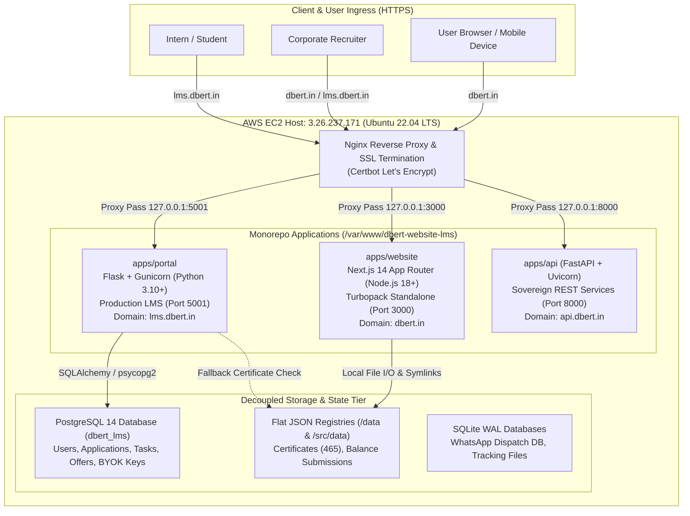
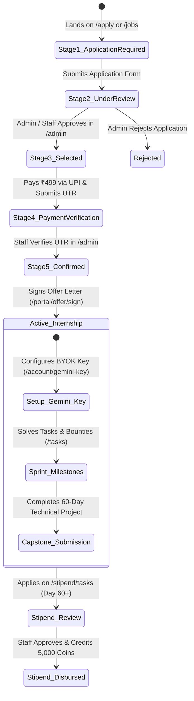
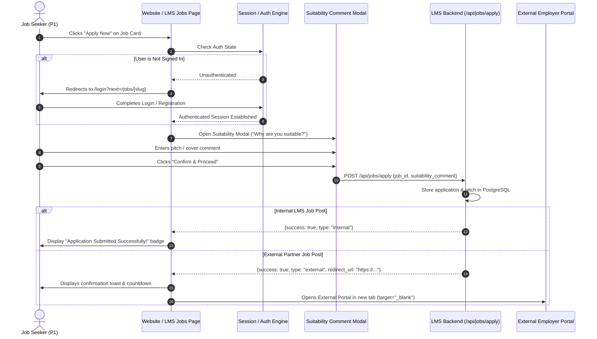
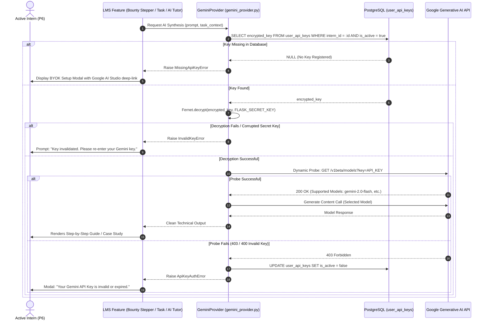
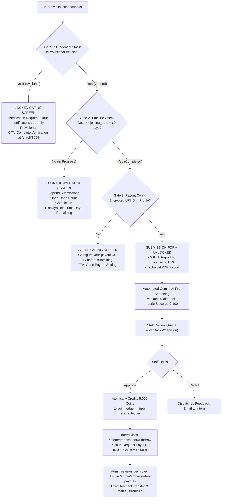
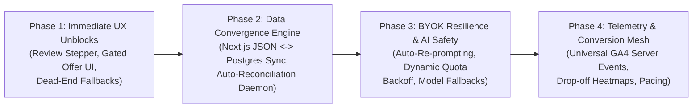
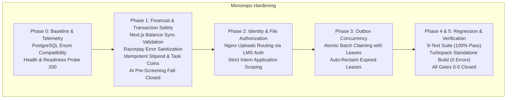

# DBERT Production Architecture Roadmap & User Flow Audit
================================================================================
Comprehensive System Topology, End-to-End User Journeys, Dead-End Audits,
Silent-Fail Remediation & Engineering Roadmap for Antigravity & AI Agents
================================================================================
*Version*: 2.0 (Post-Consolidation Baseline)  
*Last Updated*: November 2026  
*Production Host*: `ubuntu@3.26.237.171` (`/var/www/dbert-website-lms`)  
*Active Sovereign Domains*: `https://dbert.in` (Website/SSG), `https://lms.dbert.in` (Portal/LMS), `https://api.dbert.in` (FastAPI)  
*Legacy Retired Domain*: `dbert.online` (Redirects to `dbert.in`)  
*GA4 Measurement ID*: `G-MN7ME9X518`

---

## 1. System Topology & Dual-Monorepo Architecture

The DBERT platform operates as a hybrid distributed system across two primary application subtrees, a FastAPI microservice, and a decoupled data tier hosted on an AWS EC2 instance.

### 1.1. Core Application Subsystems
1. **`apps/website` (`https://dbert.in`)**:
   - **Framework**: Next.js 14 App Router, built with Turbopack in `output: 'standalone'` mode.
   - **Responsibilities**: Public branding, SEO programmatic directories (`/jobs`, `/internships`), public verification engine (`/verify`, `/verify/[certId]`, `/verify/directory`), balance completion & incubation enrollment (`/enroll/1999`, `/eroll`), domain knowledge hubs (`/learners/courses/*`).
   - **State Persistence**: Master static registries (`certificates_registry.json`, `directory_candidates.json`), file-based transaction recording (`balance_enrollments_1500.json`).
2. **`apps/portal` (`https://lms.dbert.in`)**:
   - **Framework**: Python Flask, SQLAlchemy ORM, Gunicorn WSGI.
   - **Responsibilities**: Candidate lifecycle management, applicant review, offer letter gating & signing (`/portal/offer`, `/portal/offer/sign`), bounty & milestone task tracking (`/tasks`, `/tasks/<id>/guide`), BYOK Gemini AI evaluations (`/account/gemini-key`), stipend contribution dossiers (`/stipend/tasks`), ambassador referral ledger (`/intern/ambassador`), admin and staff portals (`/admin`, `/staff/tasks`).
   - **State Persistence**: PostgreSQL (`dbert_lms` database), session cookies with Fernet encryption (`FLASK_SECRET_KEY`).
3. **Storage Disconnect & Convergence Gap**:
   - **Critical Vulnerability**: `apps/website` records candidate balance payments into `balance_enrollments_1500.json` on disk, while `apps/portal` relies on the PostgreSQL `enrollments` and `intern_accounts` tables.
   - Without an automated bidirectional sync, an intern who completes their ₹1,500 balance on the website remains in an unconfirmed status on the LMS until manually reconciled by staff.

---

## 2. User Personas & Universal Entry Points Matrix

The platform serves 8 distinct personas entering via multiple programmatic and organic landing pages.

| Persona ID | Persona Type | Primary Entry Points | Initial User State | Primary Goal | Drop-off / Risk Point |
|---|---|---|---|---|---|
| **P1** | **Anonymous Job Seeker** | `/jobs`, `/jobs/[slug]`, `/internships`, `/internships/[slug]` | Anonymous / Unauthenticated | Discover and apply for domain opportunities | Clicking "Apply" without LMS account; external posts without guidance |
| **P2** | **Fresh / Unverified Applicant** | `/apply`, `/signup`, `/auth/register` | Stage 1 (Registered, No Submission) | Complete profile, choose track, submit application | Drop-off during multi-field form or resume upload failure |
| **P3** | **Under-Review Candidate** | `/portal`, `/login` | Stage 2 (Submitted, Under Review) | Check application status, receive offer | **DEAD-END**: Static "Under Review" banner with zero actions |
| **P4** | **Selected / Deposit Pending** | `/portal`, `/portal/offer`, `/payment` | Stage 3 (Selected, Caution Deposit Pending) | Review offer letter, pay ₹499 caution deposit | Offer letter locked behind preview; hesitation on ₹499 fee |
| **P5** | **Provisional Certificate Holder** | `/enroll/1999`, `/verify/[certId]`, `/eroll` | Provisional Credential (`isProvisional: true`) | Upgrade to full verified credential or join incubation | Reluctance to pay ₹1,500 balance; confused about stipend eligibility |
| **P6** | **Active Confirmed Intern** | `/portal`, `/tasks`, `/courses`, `/account/gemini-key` | Stage 5 (Confirmed & Enrolled) | Complete sprints, earn bounty coins, build capstone | Missing BYOK Gemini key blocking task synthesis |
| **P7** | **Verified Graduate Intern** | `/stipend/tasks`, `/verify/directory`, `/intern/ambassador` | Verified Alumnus (`isProvisional: false`) | Submit stipend contribution (₹5,000 coins), request payout | Completion date gate (<60 days); UPI encryption failure |
| **P8** | **Corporate Recruiter** | `/verify/directory`, `/hire/pre-vetted-engineers` | Unauthenticated / Enterprise Seeker | Inspect candidate dossiers, verify credentials, hire | Navigating from directory to LMS company registration |

---

## 3. End-to-End User Flow Architecture & State Machines

### 3.1. 5-Stage Intern Lifecycle State Machine

### 3.2. Unified Job Application & External Post Redirect Flow

### 3.3. Monetization & Payment Tracks Sequence Architecture

```mermaid
flowchart TD
    subgraph Track_A ["Track A: Caution Deposit (₹499)"]
        A1["Candidate Selected for Internship"] --> A2["Visits /payment or /portal"]
        A2 --> A3["Scans Merchant UPI QR (Q652429146@ybl)"]
        A3 --> A4["Submits 12-Digit UPI UTR"]
        A4 --> A5["PostgreSQL enrollments status='submitted'"]
        A5 --> A6["Staff verifies in /admin -> Confirmed (Stage 5)"]
    end

    subgraph Track_B ["Track B: Incubation Balance Completion (₹1,500)"]
        B1["Provisional Intern (Paid ₹499 earlier)"] --> B2["Visits /enroll/1999?certid=..."]
        B2 --> B3["Autofills Name, College & Balance: ₹1,500"]
        B3 --> B4["Pays ₹1,500 via UPI & Submits UTR"]
        B4 --> B5["Appends to data/balance_enrollments_1500.json"]
        B5 --> B6["Shows Real-Time Live Countdown to Batch Kickoff"]
    end

    subgraph Track_C ["Track C: Direct Full Incubation (₹1,999)"]
        C1["Fresh Direct Enrollee"] --> C2["Visits /enroll/1999 without prior credit"]
        C2 --> C3["Pays full ₹1,999 Incubation Fee via UPI"]
        C3 --> C4["Records UTR in balance_enrollments_1500.json"]
    end

    subgraph Track_D ["Track D: Verified Credential Ingestion (₹299)"]
        D1["Provisional Certificate Holder"] --> D2["Fills Google Form + Uploads ₹299 Proof"]
        D2 --> D3["Python Ingestion Script Reconciles Sheet"]
        D3 --> D4["Upgrades to status='VERIFIED', isProvisional=false"]
        D4 --> D5["Full 3-Doc PDF Packet Deployed to Production"]
    end
```

### 3.4. Universal BYOK Gemini API Key Resolution Flow

### 3.5. 4-Gate Stipend Contribution & Payout Architecture

---

## 4. Comprehensive Dead-End & Drop-Off Audit

The following matrix documents critical points across the platform where users become stranded without clear actions, next steps, or recovery mechanisms.

| # | Route / Screen | Persona | Failure Mechanism / Dead-End Description | Impact | Immediate Remediation Required |
|---|---|---|---|---|---|
| **D1** | `/portal` | **P3 (Stage 2)** | Candidate in "Under Review" state sees a static banner saying *"Your application is being reviewed"*. There are no progress bars, expected turnaround dates, preparation tasks, or links to explore courses. | High drop-off; user assumes portal is broken or abandons platform. | Add an interactive "Review in Progress" stepper, estimated 48h turnaround countdown, and unlocked preview courses. |
| **D2** | `dbert.in/learners/courses/*` | **P1 / P6** | Course catalog pages have "Enroll Now" buttons calling `/api/payments/create-order` via Razorpay, but `RAZORPAY_KEY_ID` is missing/placeholder in production `.env`. | Checkout hangs or throws HTTP 500 without error handling. | Replace dead Razorpay call with direct routing to LMS enrollment or UPI QR payment checkout. |
| **D3** | `/portal/offer` | **P2 / P3** | Previously returned raw `Error 404 Page Not Found` if the candidate had not yet reached Stage 3 (Selected). | Candidate panicked thinking their account was corrupted. | Show an explanatory "Offer Not Yet Generated" status card with their current stage and next milestones. |
| **D4** | `/stipend/tasks` | **P5** | Provisional candidates were previously able to see submission inputs or received ambiguous rejections without a direct link to resolve their status. | Frustrated interns raising support tickets regarding locked stipends. | Display prominent "Verification Required" card with 1-click upgrade button to `/enroll/1999?email={email}`. |
| **D5** | `/jobs` (External Posts) | **P1** | Candidates clicked "Apply Now" on external job posts and were redirected away without DBERT recording their intent or capturing lead data. | Zero application analytics; lost user attribution. | Intercept with "Suitability Pitch" modal, save pitch in DB, then redirect in a new tab. |
| **D6** | `/account/gemini-key` | **P6** | Intern enters a revoked or non-whitelisted Gemini key. Previous code saved it blindly; tasks failed downstream during sprint execution. | Silent failure during AI evaluations and case study generation. | Pre-flight probe key against `GET /v1beta/models` before saving; show immediate green badge or inline error. |
| **D7** | `/admin/ambassador-payouts` | **P8** | If an admin rejects a payout request, no automated notification is sent to the intern, leaving the withdrawal in perpetual limbo. | Distrust in referral coin economy. | Trigger automated webhook / transactional email explaining rejection reason and unlocking coins for correction. |

---

## 5. Silent Fails & Untracked Actions Audit

This audit catalogs invisible system failures where operations fail without surfacing alerts to users, administrators, or logging daemons.

| # | Subsystem | Trigger Condition | Silent Failure Manifestation | Architectural Cause | Detection & Monitoring Fix |
|---|---|---|---|---|---|
| **S1** | **Incubation Payments** (`/enroll/1999`) | Candidate submits 12-digit UTR on Next.js website. | Record is written to `data/balance_enrollments_1500.json` on disk, but never inserted into PostgreSQL `enrollments` table on LMS. Candidate cannot log into LMS as "Paid". | Decoupled datastores with no background sync daemon connecting Next.js API to Flask DB. | Implement cron/webhook sync script (`scripts/sync_enrollments_to_postgres.py`) polling JSON and upserting into DB. |
| **S2** | **Course Payments** (Website) | User clicks "Enroll" on website course launchpad. | Browser console logs `Unhandled Promise Rejection: 500 Internal Server Error`; UI spinner spins indefinitely. | `RAZORPAY_KEY_ID` and `RAZORPAY_KEY_SECRET` are undefined in `apps/website/.env.production`. | Catch error gracefully; display fallback UPI modal or disable unconfigured payment gateways. |
| **S3** | **Fernet Key Decryption** (`apps/portal`) | Secret key rotated or candidate key encrypted under older salt. | `Fernet.decrypt()` raises `InvalidToken`; function catches exception and silently returns `None` or `""`. Downstream AI calls fail with `Missing API Key`. | Silent exception suppression in `CryptoService.decrypt()`. | Log `CRITICAL` alert on decryption failure; mark `is_active = false` and prompt intern to re-enter key. |
| **S4** | **CSRF Token Expiration** | Candidate stays on `/tasks/<id>/guide` or application form > 2 hours. | Submitting form results in HTTP 400/403 `CSRF token expired` without explanatory message; user input is wiped. | Static CSRF token injected at render time without AJAX refresh. | Intercept 403 CSRF responses; silently fetch fresh token via `/api/csrf-token` and retry submission with user draft preserved. |
| **S5** | **AI Pre-Screening Outage** | Google Generative AI API times out (504) or hits quota (429). | Task submission appears to submit, but AI score remains `NULL` and status is stuck in `pending_ai`. | No fallback retry queue or asynchronous Celery worker handling AI evaluations. | Wrap in exponential backoff; if 3 retries fail, mark `pending_staff` with badge: *"AI Evaluation Delayed - Queued for Human Review"*. |

---

## 6. Stage-by-Stage Feature Entitlement Matrix

The table below defines the strict access control and capability matrix across all candidate states.

| Platform Route / Feature | Stage 1: Fresh / Unapplied | Stage 2: Under Review | Stage 3: Selected (Deposit Pending) | Stage 4: Payment Verification | Stage 5: Confirmed (Active Intern) | Verified Alumnus (`isProvisional: false`) | Provisional Alumnus (`isProvisional: true`) |
|---|:---:|:---:|:---:|:---:|:---:|:---:|:---:|
| Public Verification (`/verify/[certId]`) | ❌ | ❌ | ❌ | ❌ | ❌ | ✅ Public / Verified | ⚠️ Marked Provisional |
| Pre-Vetted Directory (`/verify/directory`) | ❌ | ❌ | ❌ | ❌ | ❌ | ✅ Tab 1 (Pre-Vetted) | ⚠️ Tab 2 (Provisional) |
| Job Board & External Apply (`/jobs`) | ✅ Read/Apply | ✅ Read/Apply | ✅ Read/Apply | ✅ Read/Apply | ✅ Read/Apply | ✅ Read/Apply | ✅ Read/Apply |
| Portal Dashboard (`/portal`) | ❌ Redirect | ⚠️ Stage 2 Banner | ⚠️ Stage 3 Banner | ⚠️ Stage 4 Banner | ✅ Full Dashboard | ✅ Full Dashboard | ✅ Full Dashboard |
| Offer Letter View (`/portal/offer`) | ❌ Gate (404/Msg) | ❌ Gate (Pending) | ⚠️ Preview Mode | ⚠️ Preview Mode | ✅ Unlocked / Printable | ✅ Historical Record | ✅ Historical Record |
| Offer Letter Signing (`/portal/offer/sign`) | ❌ Locked | ❌ Locked | ❌ Locked (Need Pay) | ❌ Locked | ✅ Unlocked | ℹ️ Already Signed | ℹ️ Already Signed |
| Sprint Tasks & Bounties (`/tasks`) | ❌ Locked | ❌ Locked | ❌ Locked | ❌ Locked | ✅ Unlocked | ✅ Unlocked | ✅ Unlocked |
| Course-Style Bounty Stepper (`/tasks/<id>/guide`) | ❌ Locked | ❌ Locked | ❌ Locked | ❌ Locked | ✅ Unlocked (BYOK) | ✅ Unlocked (BYOK) | ✅ Unlocked (BYOK) |
| BYOK Gemini Key Config (`/account/gemini-key`) | ❌ Locked | ❌ Locked | ❌ Locked | ❌ Locked | ✅ Unlocked | ✅ Unlocked | ✅ Unlocked |
| Stipend Tasks Submission (`/stipend/tasks`) | ❌ Locked | ❌ Locked | ❌ Locked | ❌ Locked | ❌ Gate (< 60 Days) | ✅ Unlocked (Day 60+) | ❌ Locked (Gating Card) |
| Ambassador Referral Hub (`/intern/ambassador`) | ❌ Locked | ❌ Locked | ❌ Locked | ❌ Locked | ✅ Unlocked | ✅ Unlocked | ✅ Unlocked |
| Balance Completion Portal (`/enroll/1999`) | ℹ️ Full ₹1,999 | ℹ️ Full ₹1,999 | ℹ️ Net ₹1,500 | ℹ️ In Review | ℹ️ Reconciled | ℹ️ Already Verified | ⚠️ Net ₹1,500 Upgrade |

---

## 7. Strategic Engineering Remediation Roadmap

To eliminate friction, resolve dead ends, and guarantee seamless candidate progression, development is structured into 4 sequential execution phases.

### Phase 1: Immediate UX & Navigation Unblocks (Target: 48 Hours) - COMPLETED & DEPLOYED (2026-11-18)
- [x] **Task 1.1**: Deploy Stage 2 "Fast-Track Available" interactive card on `/portal` and canonical 5-stage mission guidance via `build_intern_next_action()`. Single source of truth across server Jinja and `/intern/me` JSON.
- [x] **Task 1.2**: Auto-healing academic profile sync: backfill `intern_accounts` from `applications`/`enrollments` and strictly suppress "Complete Profile" warning for Stages 3, 4, 5.
- [x] **Task 1.3**: Strict mutual exclusivity on `/portal/offer`: eliminate Step 3 QR code and UTR submission forms from DOM when caution deposit is verified (`caution_deposit_status == 'VERIFIED'`).
- [x] **Task 1.4**: Eliminate ghost card `👋 — —` by hiding `#nextStepCard` by default and isolating to `__JOB_ONLY__` applicants.

### Phase 2: Dual-Monorepo Data Convergence (Target: 1 Week)
- **Task 2.1**: Author automated reconciliation daemon `scripts/sync_enrollments_to_postgres.py` to continuously parse `data/balance_enrollments_1500.json` and upsert matching candidate records into PostgreSQL `enrollments` and `intern_accounts`.
- **Task 2.2**: Unify user authentication session between Next.js and Flask using signed cross-domain JWT cookies or shared Redis session store.
- **Task 2.3**: Eliminate flat JSON reliance for verified certificates by migrating master records into PostgreSQL `intern_certificates` as single source of truth.

### Phase 3: BYOK Resilience & Self-Healing AI Pipeline (Target: 2 Weeks)
- **Task 3.1**: Implement proactive key validation: ping `GET /v1beta/models` on save in `/account/gemini-key` and reject invalid keys before storing.
- **Task 3.2**: Add automatic fallback model cascading (`gemini-2.0-flash` -> `gemini-1.5-flash` -> `gemini-1.5-pro`) to eliminate failures during regional model rollouts.
- **Task 3.3**: Surface actionable in-modal guidance if decryption fails, prompting the intern to paste a fresh key with zero data loss.

### Phase 4: Omnichannel Telemetry & Conversion Optimization (Target: 3 Weeks)
- **Task 4.1**: Standardize server-side event tracking across Next.js and Flask dispatching to Google Analytics 4 (`G-MN7ME9X518`).
- **Task 4.2**: Implement automated abandonment triggers: dispatch recovery emails / WhatsApp notices to candidates dropping off at Stage 3 (Offer viewed but deposit unpaid after 48h).
- **Task 4.3**: Integrate automated Turnitin / AI similarity scoring telemetry into recruiter proof dossiers on `/verify/[certId]`.

---

## 8. Agent Operational Directive

When executing any engineering task on the DBERT platform, all AI agents and engineers MUST adhere to the following principles:
1. **Domain Sovereign Rule**: Always use `https://dbert.in`, `https://lms.dbert.in`, or `https://api.dbert.in`. NEVER emit `dbert.online`.
2. **Zero Dead-End Guarantee**: Every gate, locked screen, or pending state MUST provide at least one primary action CTA guiding the user to the exact route required to unlock progression.
3. **Decoupled Store Awareness**: Always verify whether a data change affects PostgreSQL (`dbert_lms`), flat JSON files (`certificates_registry.json`), or disk logs (`data/balance_enrollments_1500.json`). Update both or trigger sync scripts accordingly.
4. **Universal BYOK Fallback**: Never hardcode Gemini API keys. Always resolve through `GeminiProvider` checking `user_api_keys` with dynamic model discovery.

---

## 9. DBERT QA Remediation Master Plan & Enterprise Release Governance

The comprehensive QA remediation plan (`DBERT_QA_REMEDIATION_MASTER_PLAN.md`) addresses baseline operational defects, silent failures, payment race conditions, and background processing bottlenecks.

### 9.1. Baseline Architectural Defects Remediated (`BASE-01` to `BASE-12`)
- **BASE-01 (Next.js Balance Sync Silent Failure)**: Next.js `/api/enroll/balance` validates `syncRes.ok`. Rejects upstream failures with HTTP 400 and flags network timeouts with `QUEUED_FOR_RECONCILIATION`.
- **BASE-02 (Outbox Concurrent Multi-Worker Race)**: Atomic status leasing pattern with `STATUS_PROCESSING`, `locked_by`, and `lock_expires_at` prevents duplicate worker dispatches.
- **BASE-03 (Direct Bypass of Private File Security)**: Nginx static `/uploads/` alias removed from `api.dbert.in`. All file requests routed through Flask `FileSecurityService` to enforce HMAC and session ownership.
- **BASE-04 (Razorpay Raw Exception Stack Trace Leak)**: Sanitized payment error responses prevent DB stack trace and credentials leakage.
- **BASE-05 (SQLite Dialect Specificity in Payment Events)**: Portable `SELECT ...` existence check and conditional upsert replaces SQLite-only syntax.
- **BASE-06 (PostgreSQL Dead-Letter Case-Sensitivity in Readiness Check)**: Case-insensitive SQL queries (`LOWER(status)='dead_letter'`) ensure readiness probe reliability.
- **BASE-07 (AI Pre-Screening Fail-Open Vulnerability)**: Unconfigured or failing AI safely evaluates to `score: None` and `status: "AI_UNCONFIGURED_MANUAL_REVIEW"`, preventing automatic stipend releases.
- **BASE-08 (Stipend Ledger Double Payout on Duplicate Webhooks)**: Deterministic idempotency keys (`stipend_reward_{submission_id}`, `task_reward_{ref_id}`) enforced in `coin_ledger_mirror`.
- **BASE-09 (Application Endpoint IDOR and Cross-Tenant Data Leak)**: Intern application queries bind strictly to authenticated intern ID.
- **BASE-10 (LMS Stage Desynchronization with Offer Status)**: Offer status `ACCEPTED` synchronously projects candidate into Stage 3/5 with active next-action guidance.
- **BASE-11 (Mutual Exclusivity Violation on Offer Letter View)**: Step 3 caution deposit payment form and QR code cleanly removed from DOM when deposit is verified.
- **BASE-12 (Ghost Card & Complete Profile Banner on Advanced Stages)**: Advanced candidates (Stages 3–5) are shielded from intrusive profile prompts and ghost cards.

### 9.2. Automated Testing Suite & Verification Matrix
- **Test Suite**: `apps/portal/tests/test_qa_remediation_suite.py`
  * 9/9 PASS covering outbox leasing, lease expiration recovery, stipend ledger idempotency, AI fail-closed logic, dialect-portable payment events, private file authorization, path traversal blocking, stage action synchronization, and offer letter DOM exclusivity.
- **Build Verification**:
  * Next.js standalone build (`apps/website`): 297/297 pages generated, 0 TypeScript errors.
  * Flask LMS test suites: 100% pass across persona regression and stage synchronization tests.

---

## 10. LMS Dead-End Remediation, Multidimensional Leaderboard & Dual-Tier Certificates Architecture

### 10.1. Operational State Synchronization & Academic Profile Hardening
- **Remediation**: Eliminated state regression where accepted/signed offer holders saw "Complete Your Academic Profile" and fell back to Stage 1.
- **Architectural Guardrails**:
  1. `get_intern_flow_state()` checks `intern_offer_letters`: elevated to Stage 5 if signed and deposit-verified/unlocked; elevated to Stage 3 if offer letter exists.
  2. Auto-healing academic profile sync copies college, course, and domain from offer letters into `intern_accounts`.
  3. `needs_academic_profile` strictly forced to `False` whenever `flow_state.stage_num >= 3`.

### 10.2. Production Sovereign Leaderboard (`/leaderboard`)
- **Route**: `https://lms.dbert.in/leaderboard`
- **Scoring Engine**: Composite 7-metric formula:
  $$\text{Score} = 40 \times \text{certs} + 20 \times \text{tasks} + 10 \times \text{lessons} + 5 \times \text{hours} + 5 \times \text{quizzes} + 30 \times \text{articles} + 5 \times \text{concepts}$$
- **UI Architecture (`apps/portal/templates/leaderboard.html`)**:
  * Domain filtering pills (All, AI/ML, Data Analyst, Full Stack, Python Automation, Cybersecurity, DevOps & Cloud).
  * Top 3 podium cards (Gold, Silver, Bronze) with metrics breakdown.
  * Ranks 4–50 table view highlighting logged-in candidate row with "YOU" badge.
  * Sticky personal standing card displaying user rank, total score, sprint hours, and bounties.

### 10.3. Dual-Tier Certificates Portal (`/certificates`)
- **Route**: `https://lms.dbert.in/certificates`
- **Dual-Tier Model (`apps/portal/templates/certificates.html`)**:
  * **Pre-Vetted Engineers (66 Verified Candidates)**: Full 3-document credential dossier (Certificate, Turnitin Evaluation Rubric, Letter of Recommendation) with 1-click Master PDF print and public verification link.
  * **Incubation Fellows In-Sprints (383 Candidates)**: High-merit evaluation score badge (88/100, etc.), watermarked preview, and prominent upgrade gateway card with direct links for ₹299 Project Verification Fee (`/enroll/1999?fee=299`) or ₹1,500 Incubation Balance.
  * **LMS Course Micro-Certifications**: Grid of auto-healed certificates for completed LMS courses with print and verify actions.

### 10.4. Universal Web Push Notification Approval Modal
- Sovereign RFC 8292 NIST P-256 VAPID web push modal (`#dbertPushPermissionModal`) in `portal.html`.
- Prompts interns on first entry (`Notification.permission === 'default'`), highlighting mentor review, bounty approval, and stipend alerts.
- Subscribes device via `DBERTPush.requestPermissionAndSubscribe()` and persists endpoint in PostgreSQL `web_push_devices`.

