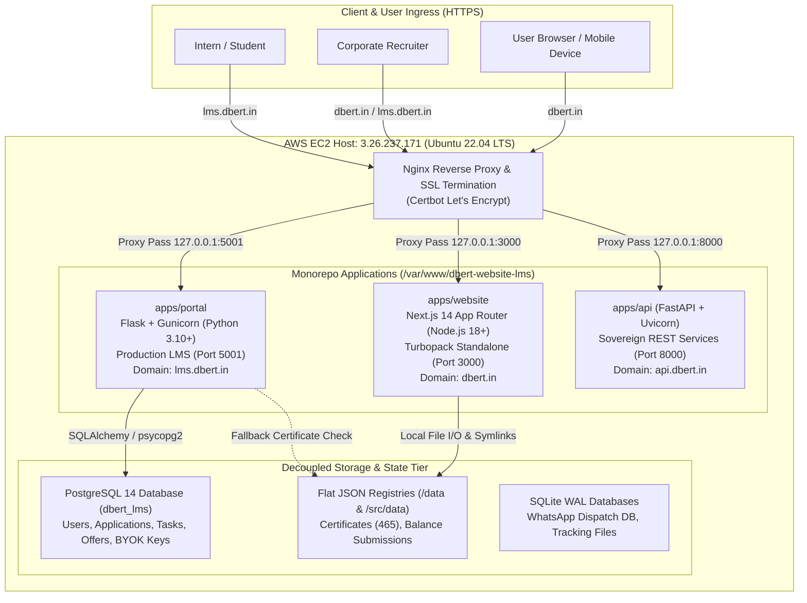
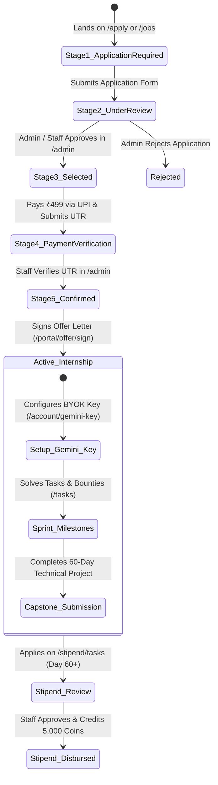
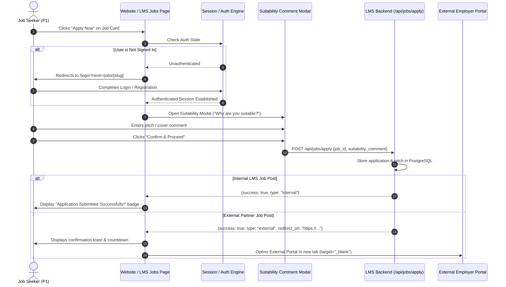
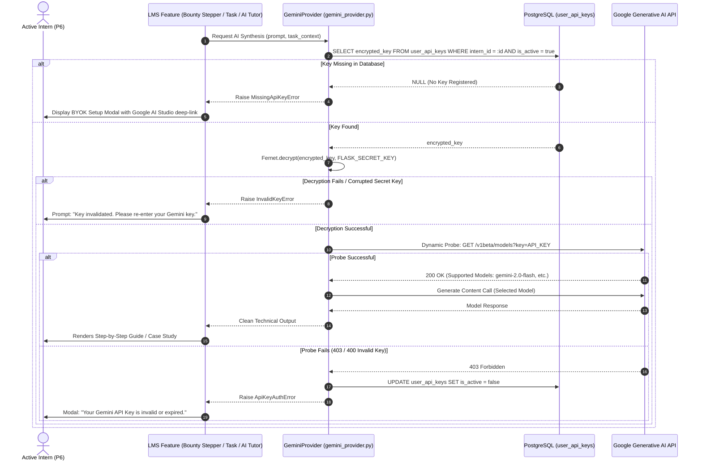
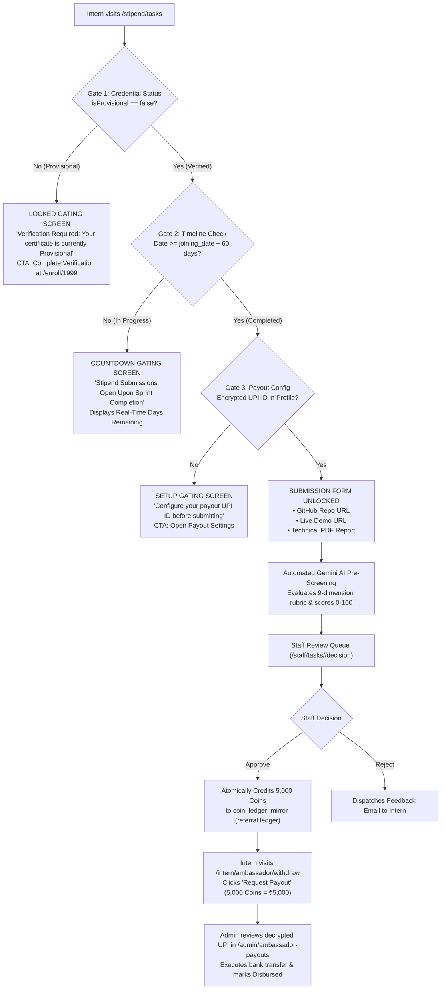
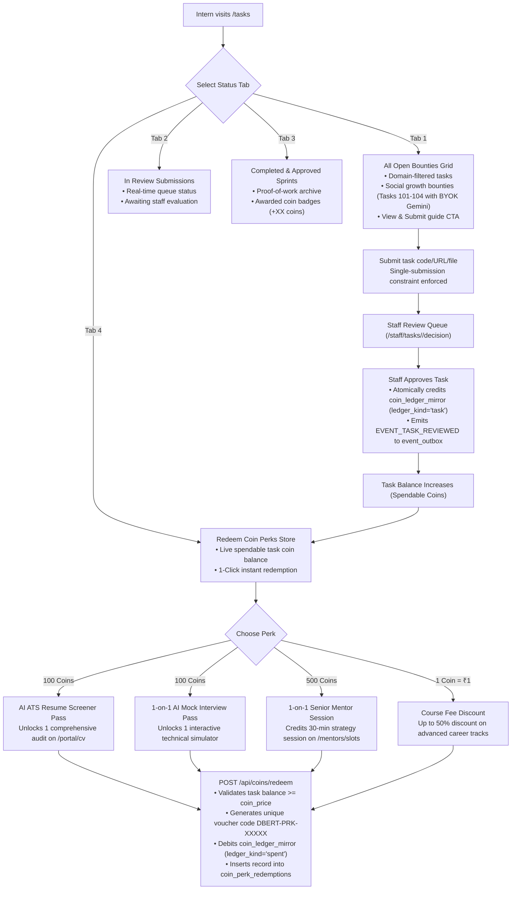
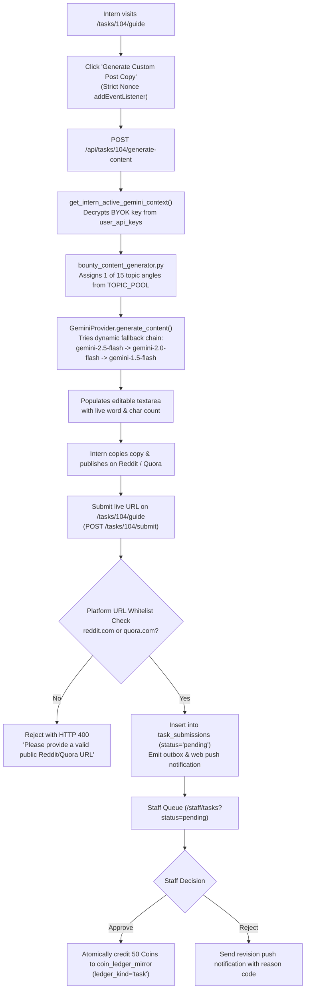
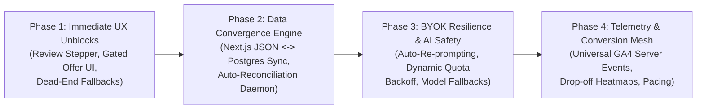
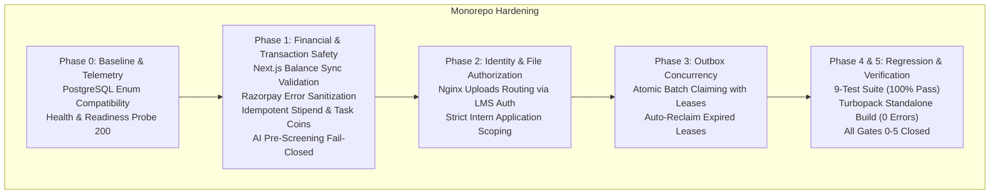

# DBERT Production Architecture Roadmap & User Flow Audit
================================================================================
Comprehensive System Topology, End-to-End User Journeys, Dead-End Audits,
Silent-Fail Remediation & Engineering Roadmap for Antigravity & AI Agents
================================================================================
*Version*: 2.0 (Post-Consolidation Baseline)  
*Last Updated*: November 2026  
*Production Host*: `ubuntu@3.26.237.171` (`/var/www/dbert-website-lms`)  
*Active Sovereign Domains*: `https://dbert.in` (Website/SSG), `https://lms.dbert.in` (Portal/LMS), `https://api.dbert.in` (FastAPI)  
*Legacy Retired Domain*: `dbert.online` (Redirects to `dbert.in`)  
*GA4 Measurement ID*: `G-MN7ME9X518`

---

## 1. System Topology & Dual-Monorepo Architecture

The DBERT platform operates as a hybrid distributed system across two primary application subtrees, a FastAPI microservice, and a decoupled data tier hosted on an AWS EC2 instance.



### 1.1. Core Application Subsystems
1. **`apps/website` (`https://dbert.in`)**:
   - **Framework**: Next.js 14 App Router, built with Turbopack in `output: 'standalone'` mode.
   - **Responsibilities**: Public branding, SEO programmatic directories (`/jobs`, `/internships`), public verification engine (`/verify`, `/verify/[certId]`, `/verify/directory`), balance completion & incubation enrollment (`/enroll/1999`, `/eroll`), domain knowledge hubs (`/learners/courses/*`).
   - **State Persistence**: Master static registries (`certificates_registry.json`, `directory_candidates.json`), file-based transaction recording (`balance_enrollments_1500.json`).
2. **`apps/portal` (`https://lms.dbert.in`)**:
   - **Framework**: Python Flask, SQLAlchemy ORM, Gunicorn WSGI.
   - **Responsibilities**: Candidate lifecycle management, applicant review, offer letter gating & signing (`/portal/offer`, `/portal/offer/sign`), bounty & milestone task tracking (`/tasks`, `/tasks/<id>/guide`), BYOK Gemini AI evaluations (`/account/gemini-key`), stipend contribution dossiers (`/stipend/tasks`), ambassador referral ledger (`/intern/ambassador`), admin and staff portals (`/admin`, `/staff/tasks`).
   - **State Persistence**: PostgreSQL (`dbert_lms` database), session cookies with Fernet encryption (`FLASK_SECRET_KEY`).
3. **Storage Disconnect & Convergence Gap**:
   - **Critical Vulnerability**: `apps/website` records candidate balance payments into `balance_enrollments_1500.json` on disk, while `apps/portal` relies on the PostgreSQL `enrollments` and `intern_accounts` tables.
   - Without an automated bidirectional sync, an intern who completes their ₹1,500 balance on the website remains in an unconfirmed status on the LMS until manually reconciled by staff.

---

## 2. User Personas & Universal Entry Points Matrix

The platform serves 8 distinct personas entering via multiple programmatic and organic landing pages.

| Persona ID | Persona Type | Primary Entry Points | Initial User State | Primary Goal | Drop-off / Risk Point |
|---|---|---|---|---|---|
| **P1** | **Anonymous Job Seeker** | `/jobs`, `/jobs/[slug]`, `/internships`, `/internships/[slug]` | Anonymous / Unauthenticated | Discover and apply for domain opportunities | Clicking "Apply" without LMS account; external posts without guidance |
| **P2** | **Fresh / Unverified Applicant** | `/apply`, `/signup`, `/auth/register` | Stage 1 (Registered, No Submission) | Complete profile, choose track, submit application | Drop-off during multi-field form or resume upload failure |
| **P3** | **Under-Review Candidate** | `/portal`, `/login` | Stage 2 (Submitted, Under Review) | Check application status, receive offer | **DEAD-END**: Static "Under Review" banner with zero actions |
| **P4** | **Selected / Deposit Pending** | `/portal`, `/portal/offer`, `/payment` | Stage 3 (Selected, Caution Deposit Pending) | Review offer letter, pay ₹499 caution deposit | Offer letter locked behind preview; hesitation on ₹499 fee |
| **P5** | **Provisional Certificate Holder** | `/enroll/1999`, `/verify/[certId]`, `/eroll` | Provisional Credential (`isProvisional: true`) | Upgrade to full verified credential or join incubation | Reluctance to pay ₹1,500 balance; confused about stipend eligibility |
| **P6** | **Active Confirmed Intern** | `/portal`, `/tasks`, `/courses`, `/account/gemini-key` | Stage 5 (Confirmed & Enrolled) | Complete sprints, earn bounty coins, build capstone | Missing BYOK Gemini key blocking task synthesis |
| **P7** | **Verified Graduate Intern** | `/stipend/tasks`, `/verify/directory`, `/intern/ambassador` | Verified Alumnus (`isProvisional: false`) | Submit stipend contribution (₹5,000 coins), request payout | Completion date gate (<60 days); UPI encryption failure |
| **P8** | **Corporate Recruiter** | `/verify/directory`, `/hire/pre-vetted-engineers` | Unauthenticated / Enterprise Seeker | Inspect candidate dossiers, verify credentials, hire | Navigating from directory to LMS company registration |

---

## 3. End-to-End User Flow Architecture & State Machines

### 3.1. 5-Stage Intern Lifecycle State Machine



### 3.2. Unified Job Application & External Post Redirect Flow



### 3.3. Monetization & Payment Tracks Sequence Architecture

```mermaid
flowchart TD
    subgraph Track_A ["Track A: Caution Deposit (₹499)"]
        A1["Candidate Selected for Internship"] --> A2["Visits /payment or /portal"]
        A2 --> A3["Scans Merchant UPI QR (Q652429146@ybl)"]
        A3 --> A4["Submits 12-Digit UPI UTR"]
        A4 --> A5["PostgreSQL enrollments status='submitted'"]
        A5 --> A6["Staff verifies in /admin -> Confirmed (Stage 5)"]
    end

    subgraph Track_B ["Track B: Incubation Balance Completion (₹1,500)"]
        B1["Provisional Intern (Paid ₹499 earlier)"] --> B2["Visits /enroll/1999?certid=..."]
        B2 --> B3["Autofills Name, College & Balance: ₹1,500"]
        B3 --> B4["Pays ₹1,500 via UPI & Submits UTR"]
        B4 --> B5["Appends to data/balance_enrollments_1500.json"]
        B5 --> B6["Shows Real-Time Live Countdown to Batch Kickoff"]
    end

    subgraph Track_C ["Track C: Direct Full Incubation (₹1,999)"]
        C1["Fresh Direct Enrollee"] --> C2["Visits /enroll/1999 without prior credit"]
        C2 --> C3["Pays full ₹1,999 Incubation Fee via UPI"]
        C3 --> C4["Records UTR in balance_enrollments_1500.json"]
    end

    subgraph Track_D ["Track D: Verified Credential Ingestion & Gate 1 Unlock (₹299)"]
        D1["Provisional Certificate Holder"] --> D2["Visits /verify/unlock + Submits ₹299 UPI UTR"]
        D2 --> D3["Python Ingestion Script Reconciles Submission Ledger"]
        D3 --> D4["Upgrades to status='VERIFIED', isProvisional=false in Registries & DB"]
        D4 --> D5["Full 3-Doc PDF Packet Deployed to Production & Gate 1 Unlocked"]
    end
```



### 3.4. Universal BYOK Gemini API Key Resolution Flow



### 3.5. 4-Gate Stipend Contribution & Payout Architecture



> [!IMPORTANT]
> **Canonical Payout Date Formula & Internal Staging Policy**:
> - **Public Communication Standard**: Payouts are scheduled strictly as **60 days after official internship end date** (end_date + 60 days). Public text, UI banners, and AI knowledge bases describe the maturation timeline as standard 60-day post-completion review and audit.
> - **Internal Operational Policy (Admin Only)**: Administrative disbursements are processed with an internal floor of **03 December 2026** (\text{Payout Date} = \max(\text{End Date} + 60\text{ days}, \text{2026-12-03})). This date is strictly an internal batch staging policy and is NOT to be broadcasted or displayed to interns or visitors on user-facing screens or sitemaps.

### 3.6. Sprint Tasks & Database-Level Coin Perks Lifecycle (`/tasks`)



> [!NOTE]
> **Strict Dual-Ledger Separation Principle**:
> - **Task Ledger (`task` / `spent`)**: Earned from sprint tasks, quizzes, streaks. Redeemable ONLY for perks and course tuition discounts.
> - **Referral Ledger (`referral` / `withdrawal`)**: Earned from ambassador referrals and ₹5,000 Capstone Stipend. Withdrawable ONLY to bank account via UPI.
> - **Zero Cross-Pollination**: Task coins cannot be withdrawn as cash; referral coins cannot be spent on courses or perks.

### 3.7. Comprehensive Seeded QA Personas Directory & Multi-Device Testing Matrix

To enable deterministic end-to-end verification across every stage of the student and recruiter lifecycle, 12 master test accounts are permanently seeded and maintained on production EC2 PostgreSQL (`dbert_internship` schema).

> [!IMPORTANT]
> **Uniform Master Password**: All test and QA personas share the exact master credentials: `TestPass123!`.

#### 3.7.1. Master QA Personas Matrix

| Persona ID | Lifecycle Stage / Role | Seeded Email / Username | Password | State / Characteristics | Canonical Live Route |
|---|---|---|:---:|---|---|
| **ADM** | **Super Administrator** | `dbert_admin@dbert.test` | `TestPass123!` | System Superuser (`role: admin`); Full access to all controls | `/admin` |
| **STF** | **Staff Reviewer** | `mentor_staff@dbert.test` | `TestPass123!` | Sprint & Capstone Evaluator (`role: staff`); Staff review queue | `/staff/tasks`, `/admin/push-broadcast` |
| **STG-1** | **Stage 1: Apply Pending** | `stage1_apply@dbert.test` | `TestPass123!` | Incomplete academic profile; Inbound application gate | `/portal` |
| **STG-2** | **Stage 2: Under Review** | `stage2_review@dbert.test` | `TestPass123!` | Applied; Technical Council Review; Fast-track badge | `/portal` |
| **STG-3A** | **Stage 3: Selected (Deposit Due)** | `stage3_selected@dbert.test` | `TestPass123!` | Appointment Issued; ₹499 Caution Deposit payable | `/portal` |
| **STG-3B** | **Stage 3: Offer Pending** | `offer_pending@dbert.test` | `TestPass123!` | Digital Offer `DBERT-OFR-2026-PA-991` awaiting signature | `/portal/offer` |
| **STG-4** | **Stage 4: Deposit In Review** | `stage4_pending@dbert.test` | `TestPass123!` | ₹499 UTR submitted; Bank reconciliation pending | `/portal` |
| **STG-5A** | **Stage 5A: Confirmed Fellow** | `fellow_enrolled@dbert.test` | `TestPass123!` | ₹499 verified; Day 2 of Full Stack Sprint active | `/portal`, `/tasks` |
| **STG-5B** | **Stage 5B: Grace Expired** | `stage5_grace_expired@dbert.test` | `TestPass123!` | 7-day orientation ended; Net ₹1,500 balance payable | `/portal`, `/enroll/1999` |
| **STG-5C** | **Stage 5C: Fully Paid Fellow** | `fellow_paid_1999@dbert.test` | `TestPass123!` | ₹1,999 fully settled; All sprints & badges unlocked | `/portal`, `/tasks`, `/certificates` |
| **STG-5D** | **Stage 5D: Gate 1 Locked** | `stipend_gate1_locked@dbert.test` | `TestPass123!` | Holds Provisional Cert (`CERT-DBERT-2026-FSD-901`); Gate 1 Locked | `/stipend/tasks` |
| **STG-5E** | **Stage 5E: Stipend Ready** | `stipend_ready@dbert.test` | `TestPass123!` | Distinction (`AIML-904`), 65+ days elapsed, UPI ready | `/stipend/tasks` |
| **STG-5F** | **Stage 5F: Withdrawable Wallet** | `stipend_wallet@dbert.test` | `TestPass123!` | 5,000 Coins credited to referral ledger; Bank UPI cashout | `/account/coins`, `/intern/ambassador/withdraw` |

#### 3.7.2. Multi-Device Viewport Verification Matrix
Every feature, modal, and data table must be verified across three canonical viewport standards:
1. **Desktop**: `1280px × 900px` (Sidebar fixed at 260px, content width 1020px).
2. **Tablet / iPad**: `820px × 1180px` (Sidebar collapsed into hamburger menu, main width 100vw).
3. **Mobile / iPhone**: `390px × 844px` (Single-column layout, touch padding `calc(env(safe-area-inset-bottom) + 80px)`, min 44px touch targets).

#### 3.7.3. Generative UI Interactive QA Launcher
An interactive Generative UI testing console is maintained at:
- Standalone Tool: [`multi_stage_device_launcher.html`](file:///C:/Users/user/.gemini/antigravity/brain/db340522-3de4-46ab-8736-005fb1623326/multi_stage_device_launcher.html)
- Inline Embed Widget: [`inline_persona_launcher_widget.html`](file:///C:/Users/user/.gemini/antigravity/brain/db340522-3de4-46ab-8736-005fb1623326/inline_persona_launcher_widget.html)
Enables 1-click credential copying, device dimension switching, and direct target route launching.

### 3.8. Omnichannel Social Bounty Tasks & BYOK Gemini Engine Architecture (`/tasks/<id>/guide`)

The platform implements 4 official 50-Coin Omnichannel Social Bounty Tasks (Tasks 101–104) enabling candidates to build in public and steer organic traffic to the ₹1,999 Incubation Fellowship:



#### 3.8.1. Omnichannel Task Domain Whitelist Matrix
| Task ID | Channel Platform | Purpose & Focus | Enforced URL Domain Filter | Coin Reward |
|:---:|---|---|---|:---:|
| **101** | LinkedIn Post / Carousel | Technical Case Study & Incubation Value | `linkedin.com` | 50 Coins |
| **102** | X (Twitter) Thread | Architecture Breakdown & Tech Salaries | `x.com`, `twitter.com` | 50 Coins |
| **103** | GitHub Repository README | Official DBERT Verified Credential Badge | `github.com` | 50 Coins |
| **104** | Reddit / Quora Q&A | Objective Engineering Review & Advice | `reddit.com`, `quora.com` | 50 Coins |

#### 3.8.2. BYOK Gemini Discovery & Free-Tier Resilience Standards
1. **Strict Nonce-CSP Compliance**: Zero inline event handlers (`onclick`, `onsubmit`) in `task_guide.html`. All listeners registered in `DOMContentLoaded` within `<script nonce="{{ csp_nonce() }}">`.
2. **Dynamic Live Model Probing (`probe_first_working_model`)**: Tests candidate models with a 1-token prompt on key registration at `/account/gemini-key`, ensuring unreleased preview strings (e.g. `gemini-3.8-flash`) are never selected over stable flash models (`gemini-2.5-flash`, `gemini-2.0-flash`, `gemini-1.5-flash`).
3. **Resilient Provider Fallbacks**: `GeminiProvider` catches 403 free-tier/permission denials and 404 retired model errors, automatically iterating down the fallback chain instead of immediately failing.

---

## 4. Comprehensive Dead-End & Drop-Off Audit

The following matrix documents critical points across the platform where users become stranded without clear actions, next steps, or recovery mechanisms.

| # | Route / Screen | Persona | Failure Mechanism / Dead-End Description | Impact | Immediate Remediation Required |
|---|---|---|---|---|---|
| **D1** | `/portal` | **P3 (Stage 2)** | Candidate in "Under Review" state sees a static banner saying *"Your application is being reviewed"*. There are no progress bars, expected turnaround dates, preparation tasks, or links to explore courses. | High drop-off; user assumes portal is broken or abandons platform. | Add an interactive "Review in Progress" stepper, estimated 48h turnaround countdown, and unlocked preview courses. |
| **D2** | `dbert.in/learners/courses/*` | **P1 / P6** | Course catalog pages have "Enroll Now" buttons calling `/api/payments/create-order` via Razorpay, but `RAZORPAY_KEY_ID` is missing/placeholder in production `.env`. | Checkout hangs or throws HTTP 500 without error handling. | Replace dead Razorpay call with direct routing to LMS enrollment or UPI QR payment checkout. |
| **D3** | `/portal/offer` | **P2 / P3** | Previously returned raw `Error 404 Page Not Found` if the candidate had not yet reached Stage 3 (Selected). | Candidate panicked thinking their account was corrupted. | Show an explanatory "Offer Not Yet Generated" status card with their current stage and next milestones. |
| **D4** | `/stipend/tasks` | **P5** | Provisional candidates were previously able to see submission inputs or received ambiguous rejections without a direct link to resolve their status. | Frustrated interns raising support tickets regarding locked stipends. | Display prominent "Verification Required" card with 1-click upgrade button to `/enroll/1999?email={email}`. |
| **D5** | `/jobs` (External Posts) | **P1** | Candidates clicked "Apply Now" on external job posts and were redirected away without DBERT recording their intent or capturing lead data. | Zero application analytics; lost user attribution. | Intercept with "Suitability Pitch" modal, save pitch in DB, then redirect in a new tab. |
| **D6** | `/account/gemini-key` | **P6** | Intern enters a key with Google Cloud free-tier restrictions. Previous code only checked `GET /models`; text generation failed downstream with 403. | Silent failure during AI evaluations and case study generation. | Live-probe key with a 1-token generation prompt before saving; automatically pin the highest-version working flash model. |
| **D7** | `/admin/ambassador-payouts` | **P8** | If an admin rejects a payout request, no automated notification is sent to the intern, leaving the withdrawal in perpetual limbo. | Distrust in referral coin economy. | Trigger automated webhook / transactional email explaining rejection reason and unlocking coins for correction. |

---

## 5. Silent Fails & Untracked Actions Audit

This audit catalogs invisible system failures where operations fail without surfacing alerts to users, administrators, or logging daemons.

| # | Subsystem | Trigger Condition | Silent Failure Manifestation | Architectural Cause | Detection & Monitoring Fix |
|---|---|---|---|---|---|
| **S1** | **Incubation Payments** (`/enroll/1999`) | Candidate submits 12-digit UTR on Next.js website. | Record is written to `data/balance_enrollments_1500.json` on disk, but never inserted into PostgreSQL `enrollments` table on LMS. Candidate cannot log into LMS as "Paid". | Decoupled datastores with no background sync daemon connecting Next.js API to Flask DB. | Implement cron/webhook sync script (`scripts/sync_enrollments_to_postgres.py`) polling JSON and upserting into DB. |
| **S2** | **Course Payments** (Website) | User clicks "Enroll" on website course launchpad. | Browser console logs `Unhandled Promise Rejection: 500 Internal Server Error`; UI spinner spins indefinitely. | `RAZORPAY_KEY_ID` and `RAZORPAY_KEY_SECRET` are undefined in `apps/website/.env.production`. | Catch error gracefully; display fallback UPI modal or disable unconfigured payment gateways. |
| **S3** | **Fernet Key Decryption** (`apps/portal`) | Secret key rotated or candidate key encrypted under older salt. | `Fernet.decrypt()` raises `InvalidToken`; function catches exception and silently returns `None` or `""`. Downstream AI calls fail with `Missing API Key`. | Silent exception suppression in `CryptoService.decrypt()`. | Log `CRITICAL` alert on decryption failure; mark `is_active = false` and prompt intern to re-enter key. |
| **S4** | **CSRF Token Expiration** | Candidate stays on `/tasks/<id>/guide` or application form > 2 hours. | Submitting form results in HTTP 400/403 `CSRF token expired` without explanatory message; user input is wiped. | Static CSRF token injected at render time without AJAX refresh. | Intercept 403 CSRF responses; silently fetch fresh token via `/api/csrf-token` and retry submission with user draft preserved. |
| **S5** | **AI Pre-Screening Outage** | Google Generative AI API times out (504) or hits quota (429). | Task submission appears to submit, but AI score remains `NULL` and status is stuck in `pending_ai`. | No fallback retry queue or asynchronous Celery worker handling AI evaluations. | Wrap in exponential backoff; if 3 retries fail, mark `pending_staff` with badge: *"AI Evaluation Delayed - Queued for Human Review"*. |

---

## 6. Stage-by-Stage Feature Entitlement Matrix

The table below defines the strict access control and capability matrix across all candidate states.

| Platform Route / Feature | Stage 1: Fresh / Unapplied | Stage 2: Under Review | Stage 3: Selected (Deposit Pending) | Stage 4: Payment Verification | Stage 5: Confirmed (Active Intern) | Verified Alumnus (`isProvisional: false`) | Provisional Alumnus (`isProvisional: true`) |
|---|:---:|:---:|:---:|:---:|:---:|:---:|:---:|
| Public Verification (`/verify/[certId]`) | ❌ | ❌ | ❌ | ❌ | ❌ | ✅ Public / Verified | ⚠️ Marked Provisional |
| Pre-Vetted Directory (`/verify/directory`) | ❌ | ❌ | ❌ | ❌ | ❌ | ✅ Tab 1 (Pre-Vetted) | ⚠️ Tab 2 (Provisional) |
| Job Board & External Apply (`/jobs`) | ✅ Read/Apply | ✅ Read/Apply | ✅ Read/Apply | ✅ Read/Apply | ✅ Read/Apply | ✅ Read/Apply | ✅ Read/Apply |
| Portal Dashboard (`/portal`) | ❌ Redirect | ⚠️ Stage 2 Banner | ⚠️ Stage 3 Banner | ⚠️ Stage 4 Banner | ✅ Full Dashboard | ✅ Full Dashboard | ✅ Full Dashboard |
| Offer Letter View (`/portal/offer`) | ❌ Gate (404/Msg) | ❌ Gate (Pending) | ⚠️ Preview Mode | ⚠️ Preview Mode | ✅ Unlocked / Printable | ✅ Historical Record | ✅ Historical Record |
| Offer Letter Signing (`/portal/offer/sign`) | ❌ Locked | ❌ Locked | ❌ Locked (Need Pay) | ❌ Locked | ✅ Unlocked | ℹ️ Already Signed | ℹ️ Already Signed |
| Sprint Tasks & Bounties (`/tasks`) | ❌ Locked | ❌ Locked | ❌ Locked | ❌ Locked | ✅ Unlocked | ✅ Unlocked | ✅ Unlocked |
| Course-Style Bounty Stepper (`/tasks/<id>/guide`) | ❌ Locked | ❌ Locked | ❌ Locked | ❌ Locked | ✅ Unlocked (BYOK) | ✅ Unlocked (BYOK) | ✅ Unlocked (BYOK) |
| BYOK Gemini Key Config (`/account/gemini-key`) | ❌ Locked | ❌ Locked | ❌ Locked | ❌ Locked | ✅ Unlocked | ✅ Unlocked | ✅ Unlocked |
| Stipend Tasks Submission (`/stipend/tasks`) | ❌ Locked | ❌ Locked | ❌ Locked | ❌ Locked | ❌ Gate (< 60 Days) | ✅ Unlocked (Day 60+) | ❌ Locked (Gating Card) |
| Ambassador Referral Hub (`/intern/ambassador`) | ❌ Locked | ❌ Locked | ❌ Locked | ❌ Locked | ✅ Unlocked | ✅ Unlocked | ✅ Unlocked |
| Balance Completion Portal (`/enroll/1999`) | ℹ️ Full ₹1,999 | ℹ️ Full ₹1,999 | ℹ️ Net ₹1,500 | ℹ️ In Review | ℹ️ Reconciled | ℹ️ Already Verified | ⚠️ Net ₹1,500 Upgrade |

---

## 7. Strategic Engineering Remediation Roadmap

To eliminate friction, resolve dead ends, and guarantee seamless candidate progression, development is structured into 4 sequential execution phases.



### Phase 1: Immediate UX & Navigation Unblocks (Target: 48 Hours) - COMPLETED & DEPLOYED (2026-11-18)
- [x] **Task 1.1**: Deploy Stage 2 "Fast-Track Available" interactive card on `/portal` and canonical 5-stage mission guidance via `build_intern_next_action()`. Single source of truth across server Jinja and `/intern/me` JSON.
- [x] **Task 1.2**: Auto-healing academic profile sync: backfill `intern_accounts` from `applications`/`enrollments` and strictly suppress "Complete Profile" warning for Stages 3, 4, 5.
- [x] **Task 1.3**: Strict mutual exclusivity on `/portal/offer`: eliminate Step 3 QR code and UTR submission forms from DOM when caution deposit is verified (`caution_deposit_status == 'VERIFIED'`).
- [x] **Task 1.4**: Eliminate ghost card `👋 — —` by hiding `#nextStepCard` by default and isolating to `__JOB_ONLY__` applicants.

### Phase 2: Dual-Monorepo Data Convergence (Target: 1 Week)
- **Task 2.1**: Author automated reconciliation daemon `scripts/sync_enrollments_to_postgres.py` to continuously parse `data/balance_enrollments_1500.json` and upsert matching candidate records into PostgreSQL `enrollments` and `intern_accounts`.
- **Task 2.2**: Unify user authentication session between Next.js and Flask using signed cross-domain JWT cookies or shared Redis session store.
- **Task 2.3**: Eliminate flat JSON reliance for verified certificates by migrating master records into PostgreSQL `intern_certificates` as single source of truth.

### Phase 3: BYOK Resilience & Self-Healing AI Pipeline (Target: 2 Weeks)
- **Task 3.1**: Implement proactive key validation: ping `GET /v1beta/models` on save in `/account/gemini-key` and reject invalid keys before storing.
- **Task 3.2**: Add automatic fallback model cascading (`gemini-2.0-flash` -> `gemini-1.5-flash` -> `gemini-1.5-pro`) to eliminate failures during regional model rollouts.
- **Task 3.3**: Surface actionable in-modal guidance if decryption fails, prompting the intern to paste a fresh key with zero data loss.

### Phase 4: Omnichannel Telemetry & Conversion Optimization (Target: 3 Weeks)
- **Task 4.1**: Standardize server-side event tracking across Next.js and Flask dispatching to Google Analytics 4 (`G-MN7ME9X518`).
- **Task 4.2**: Implement automated abandonment triggers: dispatch recovery emails / WhatsApp notices to candidates dropping off at Stage 3 (Offer viewed but deposit unpaid after 48h).
- **Task 4.3**: Integrate automated Turnitin / AI similarity scoring telemetry into recruiter proof dossiers on `/verify/[certId]`.

---

## 8. Agent Operational Directive

When executing any engineering task on the DBERT platform, all AI agents and engineers MUST adhere to the following principles:
1. **Domain Sovereign Rule**: Always use `https://dbert.in`, `https://lms.dbert.in`, or `https://api.dbert.in`. NEVER emit `dbert.online`.
2. **Zero Dead-End Guarantee**: Every gate, locked screen, or pending state MUST provide at least one primary action CTA guiding the user to the exact route required to unlock progression.
3. **Decoupled Store Awareness**: Always verify whether a data change affects PostgreSQL (`dbert_lms`), flat JSON files (`certificates_registry.json`), or disk logs (`data/balance_enrollments_1500.json`). Update both or trigger sync scripts accordingly.
4. **Universal BYOK Fallback**: Never hardcode Gemini API keys. Always resolve through `GeminiProvider` checking `user_api_keys` with dynamic model discovery.

---

## 9. DBERT QA Remediation Master Plan & Enterprise Release Governance

The comprehensive QA remediation plan (`DBERT_QA_REMEDIATION_MASTER_PLAN.md`) addresses baseline operational defects, silent failures, payment race conditions, and background processing bottlenecks.



### 9.1. Baseline Architectural Defects Remediated (`BASE-01` to `BASE-12`)
- **BASE-01 (Next.js Balance Sync Silent Failure)**: Next.js `/api/enroll/balance` validates `syncRes.ok`. Rejects upstream failures with HTTP 400 and flags network timeouts with `QUEUED_FOR_RECONCILIATION`.
- **BASE-02 (Outbox Concurrent Multi-Worker Race)**: Atomic status leasing pattern with `STATUS_PROCESSING`, `locked_by`, and `lock_expires_at` prevents duplicate worker dispatches.
- **BASE-03 (Direct Bypass of Private File Security)**: Nginx static `/uploads/` alias removed from `api.dbert.in`. All file requests routed through Flask `FileSecurityService` to enforce HMAC and session ownership.
- **BASE-04 (Razorpay Raw Exception Stack Trace Leak)**: Sanitized payment error responses prevent DB stack trace and credentials leakage.
- **BASE-05 (SQLite Dialect Specificity in Payment Events)**: Portable `SELECT ...` existence check and conditional upsert replaces SQLite-only syntax.
- **BASE-06 (PostgreSQL Dead-Letter Case-Sensitivity in Readiness Check)**: Case-insensitive SQL queries (`LOWER(status)='dead_letter'`) ensure readiness probe reliability.
- **BASE-07 (AI Pre-Screening Fail-Open Vulnerability)**: Unconfigured or failing AI safely evaluates to `score: None` and `status: "AI_UNCONFIGURED_MANUAL_REVIEW"`, preventing automatic stipend releases.
- **BASE-08 (Stipend Ledger Double Payout on Duplicate Webhooks)**: Deterministic idempotency keys (`stipend_reward_{submission_id}`, `task_reward_{ref_id}`) enforced in `coin_ledger_mirror`.
- **BASE-09 (Application Endpoint IDOR and Cross-Tenant Data Leak)**: Intern application queries bind strictly to authenticated intern ID.
- **BASE-10 (LMS Stage Desynchronization with Offer Status)**: Offer status `ACCEPTED` synchronously projects candidate into Stage 3/5 with active next-action guidance.
- **BASE-11 (Mutual Exclusivity Violation on Offer Letter View)**: Step 3 caution deposit payment form and QR code cleanly removed from DOM when deposit is verified.
- **BASE-12 (Ghost Card & Complete Profile Banner on Advanced Stages)**: Advanced candidates (Stages 3–5) are shielded from intrusive profile prompts and ghost cards.

### 9.2. Automated Testing Suite & Verification Matrix
- **Test Suite**: `apps/portal/tests/test_qa_remediation_suite.py`
  * 9/9 PASS covering outbox leasing, lease expiration recovery, stipend ledger idempotency, AI fail-closed logic, dialect-portable payment events, private file authorization, path traversal blocking, stage action synchronization, and offer letter DOM exclusivity.
- **Build Verification**:
  * Next.js standalone build (`apps/website`): 297/297 pages generated, 0 TypeScript errors.
  * Flask LMS test suites: 100% pass across persona regression and stage synchronization tests.

---

## 10. LMS Dead-End Remediation, Multidimensional Leaderboard & Dual-Tier Certificates Architecture

### 10.1. Operational State Synchronization & Academic Profile Hardening
- **Remediation**: Eliminated state regression where accepted/signed offer holders saw "Complete Your Academic Profile" and fell back to Stage 1.
- **Architectural Guardrails**:
  1. `get_intern_flow_state()` checks `intern_offer_letters`: elevated to Stage 5 if signed and deposit-verified/unlocked; elevated to Stage 3 if offer letter exists.
  2. Auto-healing academic profile sync copies college, course, and domain from offer letters into `intern_accounts`.
  3. `needs_academic_profile` strictly forced to `False` whenever `flow_state.stage_num >= 3`.

### 10.2. Production Sovereign Leaderboard (`/leaderboard`)
- **Route**: `https://lms.dbert.in/leaderboard`
- **8-Week Cohort Tenure Window & 80h Cap**:
  * Attendance hours are strictly calculated within each candidate's official 8-week internship tenure window (56 calendar days from `enrollments.joining_date` / `intern_offer_letters.batch_start_date`, or fallback `MIN(attendance.week_start)`).
  * Hours logged outside the 8-week tenure window are excluded from ranking calculations.
  * Maximum login attendance considered for points is capped at **80.0 hours** (10 hours/week $\times$ 8 weeks = max 400.0 pts from attendance). The table displays actual hours logged within the tenure window.
- **Scoring Engine**: Updated composite 7-metric formula:
  $$\text{Score} = 100 \times \text{certs} + 50 \times \text{tasks} + 25 \times \text{lessons} + 5 \times \min(\text{tenure\_hours}, 80.0) + 100 \times \text{articles} + 5 \times \text{quizzes} + 5 \times \text{concepts}$$
  * **Verified Certification**: `+100 pts` (completed credentials in `intern_certificates` where `tier != 'provisional'`).
  * **Approved Bounty Task**: `+50 pts` per approved task.
  * **Completed Sprint Lesson**: `+25 pts` per lesson completed.
  * **Platform Sprint Attendance**: `+5 pts/hr` (capped at 80.0 hrs within tenure = max 400 pts).
  * **Published Engineering Article**: `+100 pts` per approved technical publication.
  * **100% Score on Daily Quiz**: `+5 pts` per perfect quiz.
  * **Mastered Technical Concept**: `+5 pts` per mastered technical concept.
- **UI Architecture (`apps/portal/templates/leaderboard.html`)**:
  * Domain filtering pills (All, AI/ML, Data Analyst, Full Stack, Python Automation, Cybersecurity, DevOps & Cloud).
  * Top 3 podium cards (Gold, Silver, Bronze) with metrics breakdown.
  * Ranks 4–50 table view highlighting logged-in candidate row with "YOU" badge.
  * Sticky personal standing card displaying user rank, total score, sprint hours, and bounties.
  * Dedicated `.table-card-header` component with generous 1.5rem–2rem padding preventing visual clipping of table title and candidate counter against container and sidebar edges.
  * **Expandable Multidimensional Scoring Card (`#rubricCard`)**:
    - Clean accordion header with `#rubricHeader` and `#toggleRubricBtn` (`View Scoring Rules` / `Hide Scoring Rules`).
    - Collapsed by default (`display: none;`) to keep focus on top rankings, expanding smoothly on click with rotating chevron indicator.
    - Displays detailed 7-dimension scoring badge breakdown with hover interactions.
    - Strict nonce CSP compliance: zero inline `onclick`, event listeners programmatically bound in `DOMContentLoaded`.

### 10.3. Dual-Tier Certificates Portal (`/certificates`)
- **Route**: `https://lms.dbert.in/certificates`
- **Dual-Tier Model (`apps/portal/templates/certificates.html`)**:
  * **Pre-Vetted Engineers (66 Verified Candidates)**: Full 3-document credential dossier (Certificate, Turnitin Evaluation Rubric, Letter of Recommendation) with 1-click Master PDF print and public verification link.
  * **Incubation Fellows In-Sprints (383 Candidates)**: High-merit evaluation score badge (88/100, etc.), watermarked preview, and prominent upgrade gateway card with direct links for ₹299 Project Verification Fee (`/enroll/1999?fee=299`) or ₹1,500 Incubation Balance.
  * **LMS Course Micro-Certifications**: Grid of auto-healed certificates for completed LMS courses with print and verify actions.

### 10.4. Universal Web Push Notification Approval Modal & Non-Blocking Governance
- Sovereign RFC 8292 NIST P-256 VAPID web push modal (`#dbertPushPermissionModal`) in `portal.html`.
- Prompts interns on entry (`Notification.permission === 'default'`), highlighting mentor review, bounty approval, and stipend alerts.
- Subscribes device via `DBERTPush.requestPermissionAndSubscribe()` and persists endpoint in PostgreSQL `web_push_devices`.
- **Non-Blocking Mobile & Desktop UX Mandate**:
  * **Never Blocks User**: Modal is completely dismissible at all times; never traps or prevents exploring website/LMS features.
  * **Triple Dismissal Protection**: Top-right high-contrast close button (`#dbertPushModalCloseBtn`), tap-outside backdrop dismissal, and keyboard `Escape` dismissal.
  * **24-Hour Periodic Re-Prompt Cadence**: Dismissal sets a 24-hour timestamp in `localStorage` (`dbert_push_modal_dismissed_until` / `dbert_push_blocked_dismissed_until`). The user enjoys clean, uninterrupted browsing for the rest of today's session, with gentle checks on future visits.
- **Anti-Overlap & Viewport Hardening**:
  * Softened backdrop overlay with `rgba(15, 23, 42, 0.70)` and `backdrop-filter: blur(5px)` at `z-index: 100001`.
  * Desktop sidebar compensation (`@media (min-width: 821px)`): Insets left padding by `calc(var(--portal-sidebar, 260px) + 24px)` and right by `24px` to center the card within the active workspace area, preventing any visual overlap with the fixed 260px sidebar.
  * Mobile resilience (`@media (max-width: 600px)`): Fluid card width `max-width: 94vw`, comfortable touch padding (`24px 16px 20px`), `max-height: 88vh` with internal scrolling to prevent mobile screen cut-offs.
  * Vertical scroll safety (`overflow-y: auto`, max-height ceiling) prevents button clipping on short screens.
- **Dual-State Dynamic Prompt & Blocked Address Bar Guide**:
  * **State 1 (`#pushModalStateDefault`)**: Value proposition card when permission is `default`.
  * **State 2 (`#pushModalStateBlocked`)**: Shown when permission is `denied` or when the candidate clicks "Block" in the browser prompt. Shows an illustrated 3-step guide directing the user to the address bar Lock 🔒 icon to set Notifications to "Allow", with an "I've Enabled It — Refresh Page" button and a non-blocking "Dismiss for Now" button.
- **Persistent Dashboard Alert Banner (`#pushBlockedBanner`)**:
  * Rendered at the top of `#panel-overview` above `#nextActionMissionCard` whenever browser notifications are blocked.
  * Warns interns that they will miss ₹5,000 stipend release alerts and mentor code reviews, with an "Unblock Notifications" trigger to open the guidance modal.
- **Real-Time Live Recovery Engine (`navigator.permissions.query`)**:
  * Continuously monitors permission changes via W3C Permissions API. When an intern toggles notifications to "Allow" in site settings, the system immediately detects `'granted'`, auto-dismisses the modal and banner, auto-subscribes the device via `DBERTPush.autoSubscribe()`, and displays a real-time success toast without requiring a manual refresh.

---

## 11. Domain Funnel Auto-Resolution & Overview Dashboard Hierarchy (`/portal`)
- **Canonical Normalization Engine**: `normalize_domain_string()` handles all variants, synonyms, and abbreviations mapping into 9 canonical tracks.
- **Auto-Healing Multi-Table Sync**: On login or `/portal` entry, queries `intern_accounts`, `applications`, `enrollments`, `intern_offer_letters`, and `intern_certificates.course_title`. Heals `intern_accounts.domain`, enrolls intern in domain curriculum, and heals missing profile fields.
- **Stacked Dashboard Hierarchy**: `#nextActionMissionCard` (Top Stage 5 balance notice) &rarr; `#academicProfileBanner` (Onboarding Step 1 clearance) &rarr; `#overviewStepBar` (8-week timeline) &rarr; `#ovAccepted` (Full legacy active dashboard).
- **Fallback Modal**: 1-click `#domainSelectionModal` with `/api/intern/select-domain` endpoint for candidates without any recorded domain.
- **Academic Profile Route Forwarding (Option B)**: Dedicated `/profile` route permanently forwards via HTTP 302 to `/portal?tab=editprofile`, allowing candidates to complete academic records seamlessly without orphan screens.

---

## 12. Staged Offer Letter Review, Strict Signature-First Gating & Luxury Dark Seat Confirmation (`/portal/offer`)
- **Screen 1 (`#screenOfferReview`) — Transparent Review**:
  * Official appointment terms displayed in high-fidelity parchment format.
  * Delicate, transparent watermark (`rgba(254, 243, 199, 0.10)`, zero blur, faint amber lettering) ensuring 100% legibility of all terms underneath.
  * Bottom review completion bar with prominent button: `Accept & Sign Offer Letter →`.
- **Screen 2 (`#screenActionSteps`) — Strict Signature-First Gate & Seat Confirmation**:
  * Top navigation bar with `← Review Appointment Letter` back button.
  * **Strict Server-Side Gating Architecture (``)**:
    - **Unsigned State (`is_signed: False`)**:
      * Jinja strictly compiles ONLY `#offerSignCard` (Step 2: Review & Digital Acceptance).
      * `#signedBanner` ("STEP 2 COMPLETED: AGREEMENT EXECUTED / Signed by None on None") and `#postSignPaymentSection` ("STEP 3: COHORT SEAT CONFIRMATION") are physically omitted from the DOM/HTML.
      * Prevents all leaks, blank signature placeholders, and premature payment displays.
    - **Executed State (`is_signed: True`)**:
      * Jinja strictly compiles `#signedBanner` (displaying actual candidate legal name and execution timestamp recorded under Indian IT Act, 2000) and `#postSignPaymentSection` (Step 3).
      * `#offerSignCard` is physically omitted from the DOM/HTML.
    - **Digital Execution Transition Protocol**:
      * When candidate signs, AJAX POST to `/portal/offer/sign` commits signature to PostgreSQL and returns `{ status: "success" }`.
      * JavaScript displays confirmation toast: `"Appointment Agreement Digitally Signed! Loading Cohort Seat Confirmation..."` and executes `window.location.reload()`.
      * Upon reload, `is_signed` evaluates `True`, automatically revealing Screen 2 with the Executed Banner and Step 3 Payment/UTR.
  * **Step 3 UI/UX Design System Parity (`/enroll/1999` Standard)**:
    - **Left Card (Scan & Pay ₹499 + Mobile 1-Tap Fast Pay)**:
      * Dark card container: `background: #0B0F17; border: 1px solid #2A364B; border-radius: 12px; padding: 22px;`.
      * White QR box: `130px × 130px` high-contrast wrapper (`background: #FFFFFF; padding: 12px; border-radius: 12px; box-shadow: 0 4px 20px rgba(0,0,0,0.6)`).
      * High-res download button: `background: transparent; color: #E2B96F; border: 1px solid rgba(226, 185, 111, 0.4)`.
      * Merchant VPA pill: `background: #141A23; border: 1px solid #1E2633; color: #F0F4F8;` monospace with copy button (`color: #38BDF8; font-weight: 700`).
      * 1-Tap Mobile UPI Intent Launchers (2x2 Grid):
        - Google Pay: `background: #1A73E8; color: #FFFFFF !important; font-weight: 800;`
        - PhonePe: `background: #5F259F; color: #FFFFFF !important; font-weight: 800;`
        - Paytm: `background: #00BAF2; color: #FFFFFF !important; font-weight: 800;`
        - Any UPI: `background: #10B981; color: #FFFFFF !important; font-weight: 800;`
    - **Right Card (12-Digit Bank UTR Entry Form)**:
      * Dark card container: `background: #0B0F17; border: 1px solid #2A364B; border-radius: 12px; padding: 22px;`.
      * Heading: `#F0F4F8`, description `#8A9AB5`.
      * UTR input: `background: #080C14; border: 1.5px solid #2A364B; color: #F0F4F8; font-family: monospace; letter-spacing: 1.5px;`.
      * Submit button: `background: linear-gradient(135deg, #fbbf24 0%, #d97706 100%); color: #0b1120 !important; font-weight: 900;`.
      * Footer note: `border-top: 1px solid #1E2633; color: #8A9AB5; font-size: 12px;`.
- **Screen 3 / Reconciled State (`is_deposit_verified: True`)**:
  * Preview watermark eliminated.
  * Embedded candidate cursive signature and cryptographic QR seal.
  * Official Signed PDF download permanently unlocked (`/portal/offer/print`).
- **Strict Nonce CSP Compliance**:
  * All action triggers use `<button type="button">` instead of `<a>` anchors with pseudo-URLs.
  * Exactly 0 inline `onclick` or `href="javascript:..."` handlers across template.
  * Programmatic listeners bound via standard `addEventListener` in `DOMContentLoaded` within `<script nonce="{{ csp_nonce() }}">`.

---

## 13. Cohort Engineering Leaderboard & Expandable Scoring Methodology (`/leaderboard`)
- **8-Week Cohort Tenure Window Protocol**:
  * All DBERT internship cohorts operate on a strict 8-Week (56 calendar days) tenure window based on `enrollments.joining_date` or `intern_offer_letters.batch_start_date`. Attendance outside this 56-day window is strictly excluded from ranking calculations.
- **80-Hour Attendance Points Cap**:
  * Attendance points capped at 80.0 hours ($\max 400.0\text{ pts}$ at 5 pts/hr) to ensure fair merit competition.
- **7 Core Activity Metrics**:
  * Verified Certifications (+100 pts), Approved Bounty Tasks (+50 pts), Completed Lessons (+25 pts), Attendance (+5 pts/hr), Technical Articles (+100 pts), Daily Quizzes (+5 pts), Technical Concepts (+5 pts).
- **Expandable Scoring Methodology Card**:
  * Interactive collapsible card (`#scoringMethodologyCard`, `#scoringChevronIcon`) allowing users to expand and collapse the full 7-dimension competency scoring methodology table.
- **Anti-Clipping & Spacing Hardening**:
  * Standard `.table-card-header` component with generous desktop and mobile padding, preventing glyph clipping of leading characters against card borders or sidebars.

---

## 14. Sovereign Native Web Push Infrastructure & Self-Test Verification (`/account/notifications`)
- **Self-Test HTTP API Endpoints (`/api/push/test` & `/api/push/broadcast`)**:
  * Primary route `@app.route("/api/push/test", methods=["POST"])` provides dedicated self-testing for authenticated students and staff.
  * Aliased route `@app.route("/api/push/broadcast", methods=["POST"])` prevents 404 breaks for cached clients or legacy callers while safely dispatching only to the caller's devices.
  * Strict authentication requirement: Unauthenticated POSTs return 401 JSON.
  * Strict tenant scoping: Dispatches exclusively to active devices owned by the authenticated caller (`event_name="self_test"`), eliminating accidental mass broadcasts.
- **Cryptographic RFC 8292 NIST P-256 Engine**:
  * Payloads signed via `VapidManager` and encrypted via `pywebpush.webpush()`.
  * Verified live against FCM/Google Push services with status code 201 Created and `delivery_status='DELIVERED'`.
- **Delivery Audit & Last Pushed Telemetry**:
  * Every dispatch attempt logs atomically into `dbert_internship.web_push_delivery_logs`.
  * Successful push automatically updates `last_pushed_at` in `dbert_internship.web_push_devices`.
  * Dual-syncs into candidate notifications inbox in `notifications` table (`sync_inapp=True`).
- **Frontend Interactivity & Nonce CSP Hardening**:
  * `#btnTestPush` displays animated spinner during dispatch.
  * Green toast notification confirms real-time dispatch; red toast conveys server errors.
  * JavaScript dynamically updates "Last Pushed" column in device table to "Just now".
  * Exactly zero inline `onclick` handlers; strict compliance with Nonce-based Content Security Policy.

---

## 15. Admin Enrollment Payment Review Pipeline, Synchronous Lifecycle Orchestration & Robust Action Delegation (`/admin`)
- **Root Cause & Delegated Actions Hardening (`admin.html`)**:
  * Table row render previously passed `viewScreenshot` without `r.id`, leaving `_currentEnrId` uninitialized (`null`).
  * `reviewEnrollment(action)` silently exited when `_currentEnrId` was empty, causing clicks on "Accept Payment" or "Reject" to have zero effect.
  * Table row now passes `[r.id, r.payment_screenshot, r.name, r.utr||'']`.
  * `viewScreenshot(id, filename, name, utr)` initializes `_currentEnrId = id;` and auto-enriches `enrModalDetails` with candidate product, domain, email, batch, and payment status from local `PG['enr'].all` cache.
  * Interactive modal buttons (`#btnEnrAccept`, `#btnEnrReject`) disable during network requests, rendering `<i class="fas fa-spinner fa-spin"></i> Accepting...` / `Rejecting...` spinners to eliminate duplicate or silent clicks.
  * `apiFetch` attaches `X-CSRF-Token` from `<meta name="csrf-token">`.
- **Backend Multi-Table Synchronous Synchronization (`app.py`)**:
  * On Accept:
    1. `enrollments.payment_status = 'Accepted'`.
    2. `applications.status = 'Accepted'`.
    3. `intern_offer_letters.caution_deposit_status = 'VERIFIED'`, `pdf_unlocked = 1` (unlocking official signed PDF).
    4. `intern_accounts.is_active = 1` (activating LMS student workspace).
    5. Calls `handle_enrollment_accepted(conn, eid)` for ambassador code minting, course enrollment, and referral commission.
  * On Reject:
    1. `enrollments.payment_status = 'Rejected'`, saving `admin_note`.
    2. `applications.status = 'Enrollment Pending'` (or `STATUS_PAID_ENROLLED`).
    3. `intern_offer_letters.caution_deposit_status = 'REJECTED'`.
- **Multi-Channel Notification Pipeline & Isolated Resilience**:
  * All email and push dispatches run within an isolated `try...except` block, guaranteeing external SMTP or push gateway hiccups never trigger 500 errors.
  * On accept: Dispatches acceptance dossier email + real-time VAPID Web Push notification (`🎉 Enrollment Confirmed & Seat Unlocked!`).
  * On reject: Dispatches status update email with admin note + real-time VAPID Web Push notification (`⚠️ Caution Deposit Needs Resubmission`).
- **Production Verification**:
  * Complete 6-test suite (`apps/portal/tests/test_admin_enrollment_review_flow.py`) passing with 100% success on both local SQLite and live EC2 PostgreSQL production environment.

---

## 21. Universal 5-Tier Responsive & Cross-Device UI/UX Architecture (Website & LMS)
- **Standardized Breakpoint Hierarchy**:
  * XS (`< 480px`): Compact Mobile (iPhone SE, Galaxy Fold)
  * SM (`480px – 768px`): Large Mobile & Phablet (iPhone 14/15/16 Pro Max, Pixel)
  * MD (`769px – 1024px`): Tablet & Small Laptop (iPad Air/Pro, Surface)
  * LG (`1025px – 1440px`): Standard Desktop (1080p, MacBook)
  * XL (`> 1440px`): Ultrawide & 4K (constrained container widths, fluid typography)
- **Core Component Enhancements**:
  * Dense administrative and student tables convert into responsive hybrid cards or touch scroll with sticky identifier columns.
  * Landscape certificates and parchment appointment letters utilize proportional `aspect-ratio: 640 / 495` fluid containers.
  * 1-Tap UPI Launchers adapt into 2×2 mobile grids with minimum 44px touch targets.
  * Admin review modals (`#enrModal`, `#appModal`) transform into native mobile bottom sheets on screens `< 768px`.
  * Universal iOS Safari 16px auto-zoom prevention enforced on all input fields.
- **Automated Verification**:
  * Automated Playwright test script (`scripts/test_universal_responsiveness.py`) auditing 6 viewports across both `https://dbert.in` and `https://lms.dbert.in` with zero horizontal overflow.

---

## 22. Mobile Responsiveness Hardening Baseline & 27-Defect Remediation Catalog
- **Audit Scope & Scope Boundaries**:
  * Complete 27-item defect audit across public Next.js website (`apps/website`) and Flask LMS Portal (`apps/portal`).
  * Addressed WCAG 2.1 AA touch target violations (< 44px), iOS Safari auto-zoom triggers (input font-size < 16px), 320px viewport grid blowout (`minmax(320px, 1fr)`), 100vh virtual keyboard displacement (`100dvh`), and unscrollable modal dialogs.
- **Key Remediations Delivered**:
  1. **MegaMenu & Global Shell** (`MegaMenu.module.css`): Hamburger button (`.hamb`) and drawer close button (`.drawerClose`) upgraded to `44px × 44px` minimum touch target.
  2. **Modals & Popovers** (`modal.module.css`, `WhatsAppFloat.module.css`): `.box` max-height constrained to `88dvh` with smooth `-webkit-overflow-scrolling: touch;`. Modal close button widened to `44px × 44px`. Floating WhatsApp widget clearance adjusted on mobile to prevent overlaying primary submit CTAs.
  3. **Candidate Verification & Unlock** (`verify.module.css`, `unlock.module.css`): Locked certificate unlock CTA (`.lockedUnlockBtn`) enlarged to `44px` touch target with high contrast. Candidate Cert ID/Email/UTR inputs enforced to `16px !important` on screens `< 768px` to stop iOS Safari auto-zoom. Value comparison matrix table wrapped with horizontal touch scroll and `min-width: 440px`.
  4. **MultiStep Enrollment & Form Flow** (`MultiStepForm.module.css`, `CohortBanner.module.css`): Form inputs and selects enforced to `16px` on mobile. Cohort banner made wrapping (`flex-wrap: wrap;`) for 320px screen clearance.
  5. **Directory Skills & Filter Bar** (`directory.module.css`): Technical skill chips (`.skillFilterChip`), clear button (`.skillsClearBtn`), and LinkedIn filter button upgraded to `44px` touch targets on mobile.
  6. **LMS Shell & Navigation** (`portal.html`, `dbert-theme.css`): Mobile topbar hamburger (`.m-burger`) and floating shell burger (`.app-burger`) set to `44px × 44px`. Admin and mentor `.btn-sm` actions enforced to `40px–44px` touch targets on screens `< 768px`. Threaded messaging wrapper updated to `100dvh` with 16px input font sizing.
  7. **Grid Blowout Elimination** (`ambassador.html`, `certificates.html`): Replaced fixed `minmax(320px, 1fr)` grids with fluid `minmax(min(100%, 280px), 1fr)` for flawless rendering on 320px devices.
  8. **Student Guided Bounties & Stipend Tasks** (`task_guide.html`, `stipend_tasks.html`, `account_notifications.html`): Mobile hero and card paddings reduced from 28px/32px to 18px/16px; inputs updated to 16px font-size; submit buttons adapted to 100% full-width `min-height: 44px;`.
- **Deployment & Production Verification**:
  * Deployed live to AWS EC2 (`ubuntu@3.26.237.171`), Next.js standalone rebuilt, `dbert-website.service` and `dbert-portal.service` restarted.
  * Verified via automated Playwright test suite (`scripts/test_universal_responsiveness.py`) and Flask LMS test suite (`test_qa_remediation_suite.py`).

---

## 25. LMS Session Invalidation & Browser Logout Redirect Architecture (`/logout`, `/company/logout`)
- **Defect Remediation & Incident Context**:
  * Visiting or submitting to `https://lms.dbert.in/logout` rendered raw JSON payload `{"message":"Logged out.","status":"success"}` in the viewport instead of redirecting the user back to the LMS homepage (`https://lms.dbert.in/`).
  * Root cause:
    1. In `_app_shell.html` (used by 20+ intern, mentor, and company pages including `courses`, `tasks`, `certificates`, `stipend_tasks`, `ambassador`), the sidebar logout button is a standard HTML POST form with CSRF token:
       `<form method="post" action="{{ logout.href }}">{{ csrf_field() }}<button type="submit" class="btn-logout">Logout</button></form>`.
    2. Legacy `logout()` route in `apps/portal/app.py` returned `jsonify({"status": "success", "message": "Logged out."})` for any `POST` request, mistakenly assuming all POST calls were headless AJAX requests.
    3. The browser rendered the raw JSON payload and remained stranded on `https://lms.dbert.in/logout`.
- **Architectural Solution & Client Content Negotiation**:
  * Upgraded `logout()` in `apps/portal/app.py` and `apps/portal/routes/auth.py` with multi-client content negotiation:
    - If caller explicitly requests JSON (`request.is_json`, `X-Requested-With: XMLHttpRequest`, or `Accept: application/json` without `text/html`): returns `jsonify({"status": "success", "message": "Logged out.", "redirect": "/"})`.
    - For all browser requests (HTML form POST, GET direct navigation, address bar visit): invalidates session token in DB, clears session cookies via `_clear_session_cookie(resp)`, and issues an HTTP `302 Found` redirect to `"/"` (`https://lms.dbert.in/`).
    - Parity hardening applied to `/company/logout` to redirect browser companies to `/company/login` while preserving JSON responses for API clients.
- **Production Verification**:
  * Deployed to AWS EC2 (`ubuntu@3.26.237.171`) and restarted `dbert-portal.service`.
  * Verified with live authenticated student session (`stage1_apply@dbert.test`): submitting sidebar form POST to `https://lms.dbert.in/logout` yields HTTP `302 Found` and lands at `https://lms.dbert.in/` (HTTP `200 OK`) with full UI and zero raw JSON.
  * Verified unit and regression test suites (`test_security_regression.py`, `test_auth_regression.py`).


---

## 26. Production Real-Time Operations Cockpit, 5-Gate Lifecycle Baseline & Funnel Analytics

### 26.1. System Audit Overview & Infrastructure Reality
A comprehensive multi-tier audit was executed on **21 November 2026** across the live AWS EC2 production server (`ubuntu@3.26.237.171`), local transaction registries, and candidate datasets.

```
Applications (5,125) ───► Selected (4,227) ───► Caution Paid (389) ───► Verified Gate 1 (143) ───► 03 Dec Ready (20)
```

### 26.2. Master Lifecycle Funnel Architecture & Metrics
1. **Funnel 1: Ingestion & Application Stages**:
   - Total LMS Applications: **5,125**
   - Selected for Internship: **4,227** (82.5% qualification rate)
   - Accepted Offer: **407** (7.9%)
   - Rejected: **331** (6.5%)
   - Under Review: **79** (1.5%)
   - Other / Pending Enrollment: **81** (1.6%)
   - Registered Student Accounts on LMS: **2,973**
2. **Funnel 2: Monetization & Financial Gate Ledger**:
   - **Track A (₹499 Caution Deposit)**: **389 paid and accepted** in `enrollments` table (₹89,429 recorded revenue, 6 verified, 1 pending).
   - **Track B (₹1,500 Incubation Balance)**: **8 submissions** recorded in `balance_enrollments_1500.json` (2 approved, 4 pending staff review).
   - **Track D (₹299 Credential Verification)**: **25 submissions** recorded in `verification_submissions_299.json` (25 approved, 100% processed).
   - **Provisional Candidates Pending ₹299 Upgrade**: **374 certificates** in `certificates_registry.json`; **379 candidates** in Directory Tab 2.
3. **Funnel 3: Academic Sprint & Bounty Submissions**:
   - Total Task Submissions: **69**
   - Submissions Pending Staff Review: **55** (20 Capstone Dossiers + 35 General Sprint Bounties)
   - Changes Requested: **13** (8 Capstones needing student revision + 5 General)
   - Approved Submissions: **1** (Task 104 Social QA Bounty)
   - Dual Coin Ledgers:
     * Withdrawable Referral Ledger: **35,000 coins** (7 transactions)
     * Educational Task Coins Ledger: **130 coins** (2 transactions)
4. **Funnel 4: 5-Gate Stipend Release Pipeline (143 Verified Candidates)**:
   - **Gate 1 (Credential Status)**: **143 candidates** have verified credentials (`tier = 'verified'`, `isProvisional = false`).
   - **Gate 2 (Maturation Timeline)**:
     $$\text{Release Date} = \max(\text{End Date} + 60\text{ days}, \text{2026-12-03})$$
     * **138 candidates** mature on **03 December 2026** (primary release batch).
     * **5 candidates** mature on **30 December 2026** (late joining cohort).
   - **Gate 3 (Payout Setup)**: **53 candidates** have encrypted UPI configured; **90 candidates** are missing UPI setup (**Critical Action Item**).
   - **Gate 4 (Capstone Dossier)**: **28 candidates** submitted (20 pending review, 8 revision needed); **115 candidates** have not yet submitted.
   - **Gate 5 (Release Readiness)**: **20 candidates** satisfy all prerequisite gates and are **100% Ready for Release on 03 Dec 2026** pending final staff approval.

### 26.3. Interactive Generative UI Artifacts
- **Standalone Executive Operations Cockpit**:
  * File: `realtime_operations_dashboard.html`
  * Features: Full-page operations dashboard with Tailwind styling, 4 interactive tabs, real-time candidate search, filter chips (Ready for Dec 03, Missing UPI, In Review, Needs Revision), interactive SVG/CSS funnels, and 1-click CSV/JSON data export buttons.
- **Compact Inline Cockpit Widget**:
  * File: `realtime_operations_cockpit_widget.html`
  * Features: Responsive inline widget (< 450px) displaying live status pulses, 4 key KPI tiles, a 5-gate visual progress bar, and deep-link triggers.

### 26.4. Batch 35 WhatsApp Outreach Execution & Audit (21 Nov 2026)
- **Campaign Goal**: Reach high-intent locked provisional interns who have milestone tasks and release pending status, notifying them to complete their official ₹299 credential verification to unlock Gate 1 and release their ₹5,000 milestone stipend.
- **Strict Deduplication**: All candidates pre-screened against all historical WhatsApp dispatch files (`dbert_whatsapp.db`, `dbert_whatsapp_sent_today.json`, `whatsapp_unlocked_sent.json`, `dispatch_tracking_stipend_299.csv`). 100% guaranteed zero prior WhatsApp contact in 299 or stipend release campaigns.
- **Account Used**: Strictly **Account 2** (`.chrome_session_account2`), verified active and authenticated. Account 1 bypassed due to session issue.
- **Delivery Results**:
  * Total Processed: **35 candidates**
  * Confirmed Delivered (`SENT`): **35 candidates (100% success rate)**
  * Skipped: **0**
  * Failed: **0**
  * Human Pacing: 18s–35s randomized pause between deliveries.
  * Audit Artifacts: `data/whatsapp_299_queue_batch35_acc2.json`, `data/dispatch_tracking_batch35_acc2.csv`, `data/whatsapp_dispatch_299.log`, `scripts/dispatch_batch35_299_acc2.py`.
---

## Phase 28: Universal Traffic Attribution, Device Analytics & SEO Keyword Intelligence (Completed - Nov 21, 2026)
- **Client-Side Attribution**: Deployed `TrafficAttributionTracker.tsx` on `apps/website`, capturing first-touch landing pages, referrers, UTM parameters, device viewports, and non-blocking beacon to `/api/telemetry/traffic`.
- **Server-Side Nginx Log Daemon**: Implemented `scripts/parse_nginx_traffic.py` on EC2, extracting 46,939 page views, 3,493 unique visitors, 599 ChatGPT human visits, and device distributions into `data/traffic_analytics_summary.json`.
- **GSC Keyword Intelligence**: Implemented `scripts/ingest_gsc_data.py`, parsing 151 queries and identifying 8 high-intent striking-distance keywords.
- **Admin Analytics Dashboard**: Deployed `/admin/analytics` on `https://lms.dbert.in/admin/analytics` with visual KPI stat cards, channel breakdown, device split, and keyword rankings.
- **Unified Agent CLI**: Built `scripts/traffic_and_ranking_intelligence.py` with `--summary`, `--keywords`, and `--sitemap-sync` flags for Antigravity AI agents.

---

## Phase 29: Inbound Website ₹299 Gateway Reconciliation & Stipend Gate 1 Unlock (Completed - Nov 21, 2026)
- **Audit Scope**: Reconciled inbound ₹299 verification submissions from `/verify/unlock` web gateway against LMS database (`intern_accounts`, `applications`, `intern_certificates`).
- **Candidates Upgraded**:
  1. **Molugu Nanda Yaso Vardhan** (`CERT-DBERT-2026-FSD-341`, Account `#5067`, UTR `375725311685`, Score: 87, Grade A, Full Stack Web Development).
  2. **H A Uday Bhasker** (`CERT-DBERT-2026-FSD-342`, Account `#2089`, UTR `930768222270`, Score: 86, Grade A, Full Stack Web Development).
- **Deliverables & Production Sync**:
  * Generated 3-document official PDF credential packets (Completion Certificate, Academic Evaluation, LOR) in `outputs/cohort_2026/`.
  * Generated and deployed high-resolution preview PNGs to `apps/website/public/certificates/previews/`.
  * Promoted both candidates to **Tab 1: Pre-Vetted Engineers (Verified · Ready to Hire)** on `https://dbert.in/verify/directory`.
  * Updated Next.js master registries (`certificates_registry.json`, `directory_candidates.json`) and marked submissions as `APPROVED` in `data/verification_submissions_299.json`.
  * Synced PostgreSQL on EC2: inserted/updated `intern_certificates` with `tier='verified'` and set `stipend_verified=1` on `intern_accounts`, unlocking Gate 1.
  * Rebuilt Next.js standalone application on EC2 and verified all live endpoints return `HTTP 200`.
- **Stipend Maturation Date**: Both candidates completed sprints in October 2026; based on standard maturation $\max(\text{End Date} + 60\text{ days}, \text{2026-12-03})$, both are scheduled for stipend release on **03 December 2026**.

## Phase 30: Multi-Login "Under Review" Cohort Promotion & Selection WhatsApp Campaign (Completed - Nov 21, 2026)
- **Audit Scope**: Comprehensive audit of 82 applications in `Under Review` status; identified high-intent cohort with multiple session logins (`sessions_count > 1`) and zero prior ₹499 payments (10 candidates).
- **PostgreSQL Promotion on EC2**:
  * Promoted 10 applications from `Under Review` to `Selected` (`status='Selected'`, `reviewed_at=NOW()`).
  * Updated matching `intern_accounts` records: set `signup_stage=3`, `account_status='Selected'`.
  * Deterministically initialized official appointment records in `intern_offer_letters` (`DBERT-OFR-2026-...`).
  * Verified live `/portal/offer` access on EC2 (`HTTP 200`, offer ID rendered cleanly in DOM).
- **Selection WhatsApp Campaign**:
  * Queue: 9 candidates (10th candidate `Muguntharajan K` safely excluded as duplicate outreach from Batch 35).
  * Sender: Dedicated Account 2 (`.chrome_session_account2`) with 18s–35s anti-ban human pacing.
  * Compliance: Offer Letter URL placed at Line 8, Registration/Deposit Form URL placed at Line 11 (strict first-15-lines rule).
  * State Tracking: Synced to `data/selected_multi_login_cohort.json`, `data/whatsapp_selected_multi_login_queue.json`, `data/dbert_whatsapp_sent_today.json`, and `data/dispatch_tracking_selected_multi_login.csv`.


