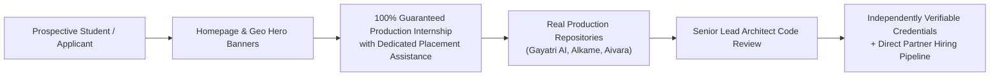
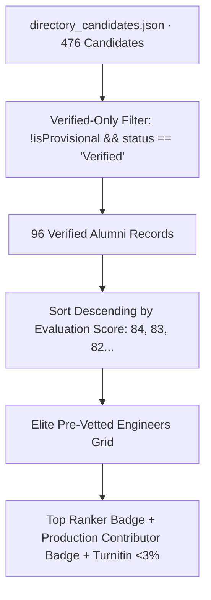
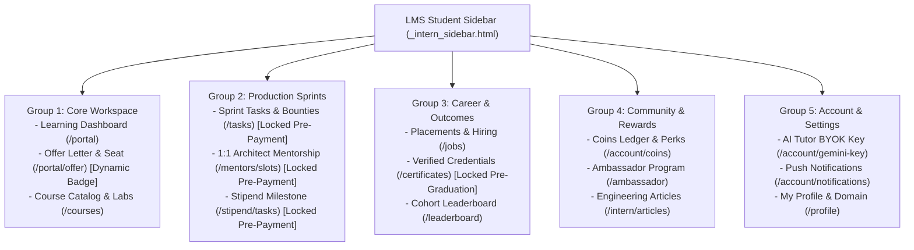
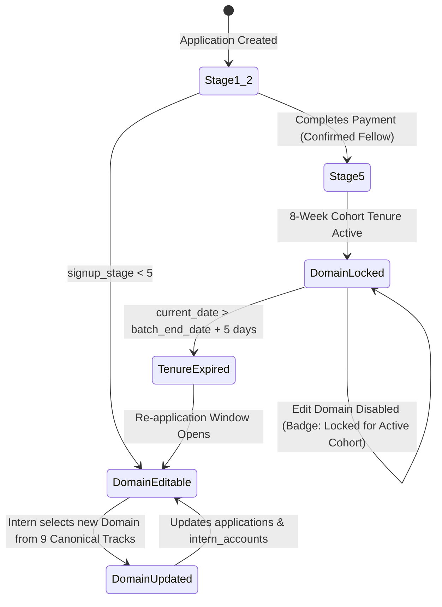
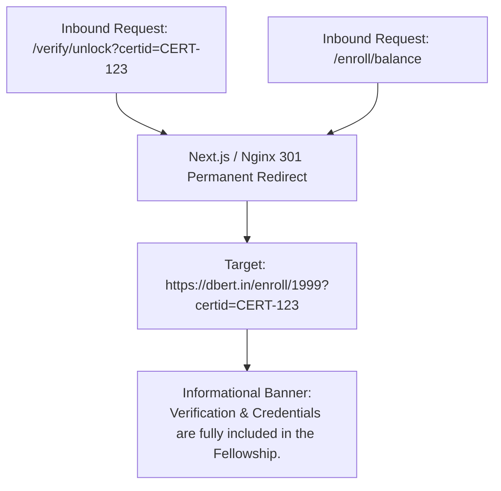
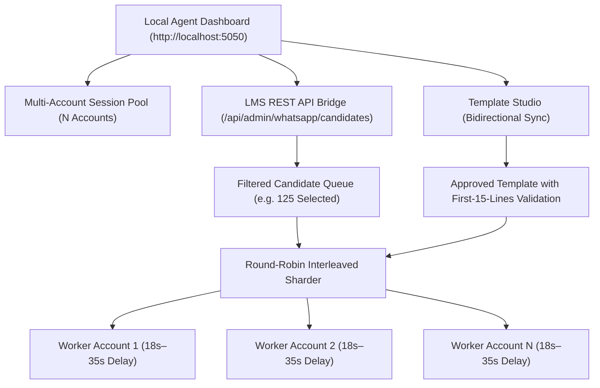

# DBERT SOVEREIGN MASTER PLAN V2 (MASTER_PLAN_V2.md)
================================================================================
Universal Multi-Phase Engineering Blueprint, Phased Implementation Plan,
Feature Gating, Navigation Restructuring & Next Agent Operations Manual
================================================================================
*Document Status*: **ACTIVE & CANONICAL SOVEREIGN EXECUTION SPECIFICATION (V2)**  
*Supersedes*: Prior ad-hoc execution roadmaps; complements `MASTER.md`  
*Current System Timestamp*: November 24, 2026  
*Production Host*: AWS EC2 `ubuntu@3.26.237.171` (`/var/www/dbert-website-lms`)  
*Primary Service Surfaces*:
- Public Venture Studio & Directory: `https://dbert.in` (Next.js Standalone · Port 3001)
- Production LMS Platform: `https://lms.dbert.in` (Flask WSGI · Port 5001)
- Sovereign Async REST Backend: `https://api.dbert.in` (FastAPI ASGI · Port 8000)
- Local WhatsApp Agent Dashboard: `http://localhost:5050` (FastAPI/Flask Local Daemon)

---

## Table of Contents
1. [Agent Directives & How to Use This Document](#1-agent-directives--how-to-use-this-document)
2. [Master Phase Progress Matrix](#2-master-phase-progress-matrix)
3. [The 9 Non-Negotiable Engineering Invariants](#3-the-9-non-negotiable-engineering-invariants)
4. [Phase 1: Realistic Value Proposition & Positioning Overhaul](#phase-1-realistic-value-proposition--positioning-overhaul)
5. [Phase 2: Pre-Vetted Engineers Directory Overhaul (/verify/directory)](#phase-2-pre-vetted-engineers-directory-overhaul-verifydirectory)
6. [Phase 3: Left-Hand Sidebar Restructuring & Visual Hierarchy](#phase-3-left-hand-sidebar-restructuring--visual-hierarchy)
7. [Phase 4: Context-Aware Feature Gating & Pre-Payment Locks](#phase-4-context-aware-feature-gating--pre-payment-locks)
8. [Phase 5: Dynamic Domain Switching & In-Profile Security Engine](#phase-5-dynamic-domain-switching--in-profile-security-engine)
9. [Phase 6: Legacy Payment 301 Redirection & Funnel Consolidation](#phase-6-legacy-payment-301-redirection--funnel-consolidation)
10. [Phase 7: Local Multi-Account WhatsApp Agent Dashboard Prototype](#phase-7-local-multi-account-whatsapp-agent-dashboard-prototype)
11. [Phase 8: Production EC2 Deployment, Rebuild & E2E Live Verification](#phase-8-production-ec2-deployment-rebuild--e2e-live-verification)
12. [Master Bug, Silent Failure & Edge Case Defensive Protocols](#12-master-bug-silent-failure--edge-case-defensive-protocols)

---

## 1. Agent Directives & How to Use This Document

> [!IMPORTANT]
> ### Instructions for Downstream AI Agents
> 1. **Canonical Sovereign Reference**: This document (`MASTER_PLAN_V2.md`) is your step-by-step master operational guide. It details *what* to build, *why* it is designed this way, *which files* are affected, *what code* to write, *how to debug*, and *how to verify*.
> 2. **Phase-by-Phase Discipline**: Never skip phases or implement code without completing the preceding phase's verification gate. Follow the strict cycle:
>    $$\text{Plan Changes} \longrightarrow \text{Inspect Target Files} \longrightarrow \text{Write Code} \longrightarrow \text{Debug \& Run Tests} \longrightarrow \text{Check Phase Gate}$$
> 3. **Mark Progress In-Place**: As you complete each task or phase, update the checkboxes `[ ]` $\to$ `[x]` and add brief commit/verification timestamps directly in this file.
> 4. **Zero Assumptions Policy**: When encountering ambiguous requirements or legacy inconsistencies, invoke `/grill-me` or ask the user directly rather than assuming.

---

## 2. Master Phase Progress Matrix

| Phase | Description | Scope & Surfaces | Status | Verified By / Date |
|---|---|---|:---:|:---:|
| **Phase 1** | Realistic Value Proposition & Positioning Overhaul | `apps/website` (Hero, Courses, Geo, SEO) | [x] **PASSED** | 357 SSG Pages, 0 Lint Errors (Nov 24, 2026) |
| **Phase 2** | Pre-Vetted Directory Overhaul (Verified Only) | `apps/website` (`/verify/directory`) | [x] **PASSED** | 96 Profiles, Tab 2 Removed (Nov 24, 2026) |
| **Phase 3** | Left-Hand Sidebar Restructuring (5 Groups) | `apps/portal` (`_intern_sidebar.html`, Shell) | [x] **PASSED** | 5 Groups, Lock Badges, 7/7 Tests (Nov 24, 2026) |
| **Phase 4** | Context-Aware Feature Gating & Pre-Payment Locks | `apps/portal` (`portal.html`, Routes, Modals)| [x] **PASSED** | `@require_confirmed_fellow`, 27/27 Tests (Nov 24, 2026) |
| **Phase 5** | Dynamic Domain Switching & In-Profile Security | `apps/portal` (`/profile`, `app.py`, DB APIs) | [x] **PASSED** | Bcrypt, Domain Lock, 50/50 Tests (Nov 24, 2026) |
| **Phase 6** | Legacy Payment 301 Redirection & Consolidation | `apps/website` (`next.config`, `/verify/unlock`)| [x] **PASSED** | 308 Redirects, Playwright 6/6 (Nov 24, 2026) |
| **Phase 7** | Local WhatsApp Multi-Account Agent Dashboard | `scripts/`, `apps/portal/app.py`, Port 5050 | [x] **PASSED** | Dashboard UI, API Bridge, Port 5050 (Nov 24, 2026) |
| **Phase 8** | Production EC2 Deployment, Rebuild & Verification | AWS EC2 Standalone, Gunicorn, Nginx | [ ] **PAUSED** | Paused for User Review Before Deploy |

---

## 3. The 9 Non-Negotiable Engineering Invariants

1. **Domain Sovereign Rule**: Always use `https://dbert.in`, `https://lms.dbert.in`, or `https://api.dbert.in`. **NEVER emit `dbert.online`** as baseUrl, active origin, in APIs, templates, WhatsApp copy, or emails.
2. **Port Allocation Invariant**:
   - `dbert.in` $\to$ **Port 3001** (Next.js standalone Node server). *Note: Nginx proxies to 3001, NOT 3000.*
   - `lms.dbert.in` $\to$ **Port 5001** (Flask + Gunicorn WSGI with 4 workers).
   - `api.dbert.in` $\to$ **Port 8000** (FastAPI + Uvicorn ASGI with 4 workers).
3. **PostgreSQL Schema Isolation**: Database is `dbert_lms` on PostgreSQL 16. All application tables reside in the `dbert_internship` schema. Always execute `SET search_path TO dbert_internship, public;` or prefix tables with `dbert_internship.<table_name>`.
4. **Zero Dead-End Guarantee**: Every gate, locked screen, or pending state MUST provide at least one primary action CTA guiding the user to the exact route required to unlock progression.
5. **Dual-Monorepo Data Awareness**: Website balance submissions are written to disk (`data/balance_enrollments_1500.json`) and reconciled via crontab every 15 minutes (`sync_enrollments_to_postgres.py`) into PostgreSQL. Never overwrite remote data with empty local files during deployment.
6. **Zero Public Stipend & Realistic Value Proposition**: Completely eliminate public mentions of '₹5,000 stipend', '₹18,000 incentive', and monthly stipend ranges from public marketing pages. The sovereign public commitment is strictly **"100% Guaranteed Production Internship with Dedicated Placement Assistance"**, emphasizing active contributions to production venture repositories (Gayatri AI, Alkame, Aivara) under senior architect code reviews. Performance stipends (5,000 coins) are strictly an internal LMS performance incentive on `/stipend/tasks`, governed by Gates 1–5, and disbursed via the referral coin ledger.
7. **Tenure Expiration & 5-Day Grace Period Invariant**: All internship tenures run strictly for 8 weeks (60 days) from the official Monday batch start date (`batch_start_date` to `batch_end_date`), with a strict 5-day grace period. Once `current_date > batch_end_date + 5 days`, the intern's tenure has officially expired and stipend eligibility is permanently voided. Their earned credentials remain permanently valid and cryptographically verified on `dbert.in/verify`, but task/stipend submissions are locked, requiring a new application and enrollment to join an active cohort.
8. **Sovereign Dual-Payment Invariant**: Across the entire DBERT ecosystem, there are strictly **ONLY TWO (2) VALID PAYMENT TYPES**:
   - **Payment 1: ₹499 Refundable Seat Caution Deposit** (merit track on `/portal/offer`, refunded upon sprint milestone clearance).
   - **Payment 2: ₹1,999 All-Inclusive Incubation & Placement Fellowship** (direct fellowship on `/enroll/1999`).
   All legacy payment surfaces (such as standalone ₹299 verification fee on `/verify/unlock` and separate ₹1,500 balance completion) are permanently retired and paused on active pages; inbound traffic to `/verify/unlock` issues a strict 301 Permanent Redirect to `/enroll/1999`.
9. **Four-Pillar Fellowship Graduation Standard**: To qualify for official graduation, verified 3-document credential packet issuance, Tab 1 placement directory indexing, and caution deposit refund, fellows must fulfill:
   (1) **80 Sprint Attendance Hours** logged via the global heartbeat engine,
   (2) **75 Phased Bounty Tasks** completed in the LMS across 8 weekly sprints,
   (3) **1 Merged Production Pull Request** on DBERT repositories verified via Hybrid GitHub API + 1-Click Architect Approval, and
   (4) **Technical Capstone Report** with Turnitin Originality Clearance (< 3%).
10. **₹5,000 Stipend Release Verification Invariant**: `stipend_verified = 1` on `intern_accounts` tracks legacy **Gate 1** (₹299 credential verification cleared). Final **₹5,000 Stipend Release** (`stipend_5000_status = 'Approved'`) strictly requires: (a) **LinkedIn Certification URL added & verified** (`linkedin_url` / `linkedin_verified = 1`), (b) **Merged Pull Request URL** (`/pull/<id>`) on official DBERT GitHub repositories (`Alkameinc`, `Gayatri-Education`, `Aivaratechinfomatics`, `DBERT-INDIA`), and (c) **Admin Audit & Comment Review** via `/admin/stipend-reviews` (persisting `stipend_5000_status`, `stipend_release_date`, and `admin_stipend_comment` for `/portal` visibility).

---

## Phase 1: Realistic Value Proposition & Positioning Overhaul

### 1.1. Objective
Refine all public-facing copy across `apps/website` to universally reflect **"100% Guaranteed Production Internship with Dedicated Placement Assistance"**. The copy must clearly and transparently inform candidates that they will work on real production repositories (Gayatri AI, Alkame, Aivara) under senior code review, eliminating hype or misleading permanent job guarantees.

### 1.2. Architecture & Flow Diagram


### 1.3. Files Affected
- `apps/website/src/app/page.tsx`
- `apps/website/src/app/page.module.css`
- `apps/website/src/components/courses/CourseInteractiveShell.tsx`
- `apps/website/src/components/forms/TrackLeadCaptureForm.tsx`
- `apps/website/src/data/geo_domains.config.ts`
- `apps/website/src/app/internships/page.tsx`
- `apps/website/src/app/internships/[role]/page.tsx`
- `apps/website/src/app/internships/[role]/[city]/page.tsx`
- `apps/website/src/app/learners/page.tsx`
- `apps/website/src/app/pricing/page.tsx`

### 1.4. Step-by-Step Implementation Instructions
1. **Homepage Hero (`apps/website/src/app/page.tsx`)**:
   - Locate the hero badge and subtitle. Update to:
     ```tsx
     <span className={styles.heroBadge}>
       <i className="fa-solid fa-shield-check" /> 100% Guaranteed Production Internship · Dedicated Placement Assistance
     </span>
     ```
   - In the value proposition paragraph:
     ```tsx
     <p className={styles.heroDescription}>
       Contribute directly to active production codebases under senior architect code review across Gayatri AI, Alkame, and Aivara. Gain verified engineering credentials and dedicated placement support.
     </p>
     ```
2. **Course Interactive Shell (`apps/website/src/components/courses/CourseInteractiveShell.tsx`)**:
   - Ensure the dual-track switch and guarantee banner display:
     ```tsx
     <div className={s.guaranteeBanner}>
       <i className="fa-solid fa-code-commit" />
       <span>100% Guaranteed Production Internship with Dedicated Placement Assistance</span>
     </div>
     ```
   - In the track features bullet list, explicitly include:
     * *Active Production Repositories*: Hands-on commits and architect PR reviews on Gayatri AI & Alkame.
     * *Placement Assistance*: Direct indexing on `/verify/directory` and recruiter pipeline matching.
3. **Geo-Internship Programmatic Config (`apps/website/src/data/geo_domains.config.ts`)**:
   - Update template headline generation:
     ```typescript
     export function generateCityHeadline(role: string, city: string): string {
       return `${role} in ${city} — 100% Guaranteed Production Internship with Dedicated Placement Assistance`;
     }
     ```
4. **Pricing Page (`apps/website/src/app/pricing/page.tsx`)**:
   - Under the ₹1,999 Fellowship tier, highlight:
     * Production Internship Guarantee
     * Dedicated Placement Assistance
     * Zero Public Cash Handout / Performance-indexed internal bounties only

### 1.5. Debugging & Edge-Case Runbook
- *Edge Case*: Stale browser cache showing old "job placement" headline.
  *Fix*: Increment CSS version/timestamp or rebuild Next.js standalone cache.
- *Edge Case*: Mobile viewport text clipping on long banner titles.
  *Fix*: Ensure `white-space: normal`, `word-break: break-word`, and `font-size: clamp(12px, 3.5vw, 15px)`.

### 1.6. Verification & Phase Gate
```powershell
# Run Next.js lint and type-check locally
cd apps/website
npm run lint
npm run build
```
- [ ] Inspect `https://dbert.in` hero: confirms "100% Guaranteed Production Internship with Dedicated Placement Assistance".
- [ ] Inspect sample course page `/courses/full-stack-development`: confirms production repository emphasis.
- [ ] Inspect sample geo page `/internships/data-analyst/bengaluru`: confirms updated headline.

---

## Phase 2: Pre-Vetted Engineers Directory Overhaul (`/verify/directory`)

### 2.1. Objective
Permanently eliminate `Tab 2: Incubation Fellows (Provisional)`, presenting a single, uncompromised public directory of **100% Cryptographically Verified Top Rankers & High-Performing Engineering Assets** sorted dynamically by academic distinction (Scores 80–88, Grade A Top Distinction).

### 2.2. Architecture & Flow Diagram


### 2.3. Files Affected
- `apps/website/src/app/verify/directory/DirectoryClient.tsx`
- `apps/website/src/app/verify/directory/directory.module.css`
- `apps/website/src/app/verify/directory/page.tsx`

### 2.4. Step-by-Step Implementation Instructions
1. **Remove Tab Switcher State in `DirectoryClient.tsx`**:
   - Delete `const [activeTab, setActiveTab] = useState<'VERIFIED' | 'PROVISIONAL'>('VERIFIED');`.
   - Remove `<div className={s.tabShell}>...</div>` and the associated provisional tab button.
2. **Enforce Verified-Only & Score Descending Filter**:
   ```tsx
   const filteredCandidates = useMemo(() => {
     return candidates
       .filter((c) => !c.isProvisional && (c.status === 'Verified' || c.verified))
       .filter((c) => {
         if (selectedDomain !== 'ALL' && normalizeDomainToSlug(c.domain) !== selectedDomain) return false;
         if (minScore > 0 && (c.score || 0) < minScore) return false;
         if (searchQuery.trim()) {
           const q = searchQuery.toLowerCase();
           const matchName = c.holderName.toLowerCase().includes(q);
           const matchDomain = c.domain.toLowerCase().includes(q);
           const matchCert = c.certId.toLowerCase().includes(q);
           if (!matchName && !matchDomain && !matchCert) return false;
         }
         return true;
       })
       .sort((a, b) => (b.score || 0) - (a.score || 0)); // Highest evaluation score first
   }, [candidates, selectedDomain, minScore, searchQuery]);
   ```
3. **Add Elite Performance Badges in Candidate Card**:
   ```tsx
   <div className={s.cardBadges}>
     {c.score >= 80 && (
       <span className={s.badgeTopRanker}>
         <i className="fa-solid fa-crown" /> Top Ranker · Grade A
       </span>
     )}
     <span className={s.badgeAsset}>
       <i className="fa-solid fa-code-branch" /> Production Contributor
     </span>
     <span className={s.badgeTurnitin}>
       <i className="fa-solid fa-shield-check" /> Turnitin Verified &lt; 3%
     </span>
   </div>
   ```
4. **Update Header Banner & Metrics**:
   - Update total verified asset counter: displays `96 Pre-Vetted Engineers Available`.
   - Update hero description:
     *"Every engineer listed here has completed verified production codebase sprints, achieved merit clearance on rigorous 9-dimension evaluation rubrics, and holds cryptographically signed credentials."*

### 2.5. Debugging & Edge-Case Runbook
- *Edge Case*: 0 results displayed if data format mismatch (`c.isProvisional` vs `c.verified`).
  *Fix*: Check `!c.isProvisional && (c.status === 'Verified' || c.verified === true)`.
- *Edge Case*: Tie in scores.
  *Fix*: Secondary sort by candidate name alphabetical: `(b.score || 0) - (a.score || 0) || a.holderName.localeCompare(b.holderName)`.

### 2.6. Verification & Phase Gate
```powershell
# Test rendering of directory client
npm run build
```
- [ ] Visit `/verify/directory`: Confirm Tab switcher is 100% gone.
- [ ] Confirm only verified profiles are displayed (count = 96).
- [ ] Confirm candidate cards show top rankers first (84, 83...) with `Top Ranker` and `Production Contributor` badges.

---

## Phase 3: Left-Hand Sidebar Restructuring & Visual Hierarchy

### 3.1. Objective
Restructure the student navigation sidebar in `apps/portal/templates/_intern_sidebar.html` and `_app_shell.html` into a logical 5-group priority hierarchy (`Core Workspace`, `Production Sprints`, `Career & Outcomes`, `Community & Rewards`, `Account & Settings`) with dynamic lock badges (`fa-lock`), pulse pills, and responsive styling.

### 3.2. Architecture & Flow Diagram


### 3.3. Files Affected
- `apps/portal/templates/_intern_sidebar.html`
- `apps/portal/templates/_app_shell.html`
- `apps/portal/static/css/dbert-theme.css`

### 3.4. Step-by-Step Implementation Instructions
1. **Define the 5 Priority Groups in `_intern_sidebar.html`**:
   Replace legacy `nav_groups` with the structured hierarchy:
   ```jinja2
   {% set nav_groups = [
     {'label': 'Core Workspace', 'items': [
       {'href': '/portal',            'icon': 'fa-solid fa-gauge',          'label': 'Learning Dashboard', 'match': ['dashboard', 'portal']},
       {'href': '/portal/offer',      'icon': 'fa-solid fa-file-signature', 'label': 'Offer Letter & Seat', 'match': ['offer'], 'badge': offer_badge or 'OFFICIAL', 'pulse': is_selected_unpaid},
       {'href': '/courses',           'icon': 'fa-solid fa-graduation-cap', 'label': 'Course Catalog & Labs','match': ['courses']}
     ]},
     {'label': 'Production Sprints', 'items': [
       {'href': '/tasks',             'icon': 'fa-solid fa-list-check',     'label': 'Sprint Tasks & Bounties', 'match': ['tasks'], 'locked': is_locked_pre_payment, 'badge': sprint_task_badge},
       {'href': '/mentors/slots',     'icon': 'fa-solid fa-calendar-check', 'label': '1:1 Architect Mentorship', 'match': ['sessions'], 'locked': is_locked_pre_payment},
       {'href': '/stipend/tasks',     'icon': 'fa-solid fa-money-bill-wave','label': 'Stipend Milestone', 'match': ['stipend'], 'locked': is_locked_pre_payment, 'badge': '₹5,000'}
     ]},
     {'label': 'Career & Outcomes', 'items': [
       {'href': '/jobs',              'icon': 'fa-solid fa-briefcase',      'label': 'Placements & Hiring', 'match': ['jobs', 'internships']},
       {'href': '/certificates',      'icon': 'fa-solid fa-award',          'label': 'Verified Credentials', 'match': ['certificates', 'certificate'], 'locked': not is_graduated},
       {'href': '/leaderboard',       'icon': 'fa-solid fa-trophy',         'label': 'Cohort Leaderboard', 'match': ['leaderboard']}
     ]},
     {'label': 'Community & Rewards', 'items': [
       {'href': '/account/coins',     'icon': 'fa-solid fa-coins',          'label': 'Coins Ledger & Perks', 'match': ['coins']},
       {'href': '/ambassador',        'icon': 'fa-solid fa-gift',           'label': 'Ambassador Program', 'match': ['ambassador']},
       {'href': '/intern/articles',   'icon': 'fa-solid fa-feather-pointed','label': 'Engineering Articles', 'match': ['articles']}
     ]},
     {'label': 'Account & Settings', 'items': [
       {'href': '/account/gemini-key','icon': 'fa-solid fa-key',            'label': 'AI Tutor BYOK Key', 'match': ['gemini_key']},
       {'href': '/account/notifications','icon': 'fa-solid fa-bell',        'label': 'Push Notifications', 'match': ['notifications']},
       {'href': '/profile',           'icon': 'fa-solid fa-user-gear',      'label': 'My Profile & Domain', 'match': ['profile', 'editprofile']}
     ]}
   ] %}
   ```
2. **Update `_app_shell.html` to Render Lock Badges**:
   ```jinja2
   <a href="{{ item.href }}"
      class="nav-item active nav-item-locked"
      data-locked="true"
      aria-current="page">
     <i class="{{ item.icon }}"></i><span>{{ item.label }}</span>
     
       <span class="nav-lock-pill"><i class="fa-solid fa-lock"></i> LOCKED</span>
     
       <span class="nav-badge nav-badge-pulse">{{ item.badge }}</span>
     
   </a>
   ```
3. **Styling in `dbert-theme.css`**:
   ```css
   .nav-lock-pill {
     font-size: 9.5px;
     font-weight: 800;
     padding: 2px 7px;
     border-radius: 6px;
     background: rgba(148, 163, 184, 0.15);
     color: #64748b;
     display: inline-flex;
     align-items: center;
     gap: 4px;
     margin-left: auto;
   }
   .nav-item-locked:hover .nav-lock-pill {
     background: rgba(239, 68, 68, 0.15);
     color: #ef4444;
   }
   .nav-badge-pulse {
     animation: badgePulse 2s infinite ease-in-out;
   }
   @keyframes badgePulse {
     0%, 100% { opacity: 1; transform: scale(1); }
     50% { opacity: 0.8; transform: scale(1.05); }
   }
   ```

### 3.5. Debugging & Edge-Case Runbook
- *Edge Case*: Jinja dict method collision (`items` vs `keys`).
  *Fix*: Always access dictionary list using `group['items']`.
- *Edge Case*: Mobile navigation drawer clipping lock badges.
  *Fix*: Ensure `.nav-item` has `min-height: 42px` and `display: flex; align-items: center; justify-content: space-between`.

### 3.6. Verification & Phase Gate
- [ ] Inspect LMS as active intern: Confirm all 5 groups render with crisp typography and icons.
- [ ] Inspect locked items: Confirm `LOCKED` badge displays cleanly on right edge.

---

## Phase 4: Context-Aware Feature Gating & Pre-Payment Locks

### 4.1. Objective
Enforce strict access control in LMS before selection and before payment confirmation (₹499 Caution Deposit or ₹1,999 Incubation Fellowship). Unselected applicants are guided to `/portal`, while selected unpaid candidates are routed to `/portal/offer`.

### 4.2. Architecture & State Transition Matrix
| Candidate Lifecycle State | `signup_stage` | Access to `/tasks` & `/mentors/slots` | Locked Click Target | User Message |
|---|:---:|:---:|:---:|---|
| **Stage 1 (Incomplete)** | 1 | ❌ LOCKED | `/portal` | Complete intake application to begin review. |
| **Stage 2 (Under Review)** | 2 | ❌ LOCKED | `/portal` | Application under review (48h SLA). |
| **Stage 3 (Selected · Unpaid)**| 3 | ❌ LOCKED | `/portal/offer` | Selection offer ready! Confirm seat to unlock. |
| **Stage 4 (Deposit Submitted)**| 4 | ❌ LOCKED | `/portal` | Payment under bank reconciliation (2–4h). |
| **Stage 5 (Confirmed Fellow)** | 5 | ✅ UNLOCKED | Direct Access | Full production sprint workspace active. |

### 4.3. Files Affected
- `apps/portal/templates/portal.html`
- `apps/portal/app.py`
- `apps/portal/routes/intern.py`
- `apps/portal/templates/tasks_list.html`
- `apps/portal/templates/stipend_tasks.html`

### 4.4. Step-by-Step Implementation Instructions
1. **Frontend Interceptor in `_app_shell.html` / `portal.html`**:
   ```javascript
   document.addEventListener('DOMContentLoaded', function() {
     document.querySelectorAll('.nav-item-locked').forEach(function(item) {
       item.addEventListener('click', function(e) {
         e.preventDefault();
         const stage = window._USER_SIGNUP_STAGE || 2;
         if (stage < 3) {
           showGateModal(
             'Application Under Review',
             'Your application is currently being evaluated by the DBERT Technical Council. Once selected, your production sprint tasks, 1:1 mentorship, and codebase repos will unlock automatically.',
             '/portal',
             'View Review Status'
           );
         } else if (stage === 3) {
           showGateModal(
             'Seat Confirmation Required',
             'Congratulations on your official selection! Please review and sign your appointment letter and complete your seat confirmation on /portal/offer to unlock your sprint workspace.',
             '/portal/offer',
             'Proceed to Seat Confirmation →'
           );
         } else if (stage === 4) {
           showGateModal(
             'Reconciliation in Progress',
             'Your payment UTR submission is currently being matched against merchant banking records. Your workspace will unlock automatically within 2–4 hours.',
             '/portal',
             'Check Status'
           );
         }
       });
     });
   });
   ```
2. **Backend Route Gating Decorator (`apps/portal/app.py`)**:
   ```python
   def require_confirmed_fellow(f):
       @wraps(f)
       def decorated_function(*args, **kwargs):
           user = get_current_intern()
           if not user:
               return redirect("/intern/login")
           stage = user.get("signup_stage", 2)
           if stage < 3:
               flash("Your application is currently under review. Sprint features unlock upon selection.", "info")
               return redirect("/portal")
           elif stage == 3:
               flash("Please complete your seat confirmation on /portal/offer to unlock production sprint tasks.", "warning")
               return redirect("/portal/offer")
           elif stage == 4:
               flash("Your payment is being verified. Your workspace will unlock shortly.", "info")
               return redirect("/portal")
           return f(*args, **kwargs)
       return decorated_function
   ```
3. **Protect Sprints Endpoints**:
   Apply `@require_confirmed_fellow` to:
   - `/tasks` and `/tasks/<id>`
   - `/mentors/slots` and `/mentors/slots/<id>/book`
   - `/stipend/tasks`

### 4.5. Debugging & Edge-Case Runbook
- *Edge Case*: Direct URL navigation bypassing sidebar lock.
  *Fix*: Backend decorator `@require_confirmed_fellow` strictly intercepts direct GET/POST requests and issues contextual redirect.
- *Edge Case*: Candidate with approved ₹1,500 balance or ₹1,999 direct enrollment flagged as unpaid.
  *Fix*: Ensure `sync_enrollments_to_postgres.py` atomically updates `signup_stage = 5` and `account_status = 'Confirmed Fellow'`.

### 4.6. Verification & Phase Gate
```powershell
# Run unit tests on gating engine
pytest apps/portal/tests/unit/test_dynamic_next_action_engine.py
```
- [ ] Log in as Stage 2 user: clicking `/tasks` routes to `/portal` with "Under Review" notice.
- [ ] Log in as Stage 3 user: clicking `/tasks` routes to `/portal/offer` with "Seat Confirmation" notice.
- [ ] Log in as Stage 5 user: clicking `/tasks` opens task workspace with 0 redirects.

---

## Phase 5: Dynamic Domain Switching & In-Profile Security Engine

### 5.1. Objective
Allow candidates to change their internship domain *before* cohort enrollment (`signup_stage < 5`), lock the domain during active 8-week sprint tenure, unlock post-tenure for re-application, and integrate in-profile password updates.

### 5.2. Architecture & Domain Switching Rules


### 5.3. Files Affected
- `apps/portal/templates/portal.html` (`panel-editprofile`)
- `apps/portal/app.py`
- `apps/portal/templates/_head.html`

### 5.4. Step-by-Step Implementation Instructions
1. **Dynamic Domain Select in `portal.html` (`panel-editprofile`)**:
   ```html
   <div class="form-group">
     <label class="field-label" for="ep_domain">
       Internship Track / Domain
       <span id="domainLockBadge" class="badge-lock"></span>
     </label>
     <select id="ep_domain" class="field-select">
       <option value="Full Stack Web Development">Full Stack Web Development</option>
       <option value="Data Analyst">Data Analyst</option>
       <option value="AI Agent Development">AI Agent Development</option>
       <option value="Python Automation">Python Automation</option>
       <option value="UI/UX Design">UI/UX Design</option>
       <option value="DevOps & Cloud">DevOps & Cloud</option>
       <option value="Mobile App Development">Mobile App Development</option>
       <option value="Cybersecurity">Cybersecurity</option>
       <option value="Digital Marketing">Digital Marketing</option>
     </select>
     <p class="field-hint" id="domainHint"></p>
   </div>
   ```
2. **Client-Side Lock Resolution (JavaScript)**:
   ```javascript
   function populateProfileData(u) {
     document.getElementById('ep_name').value = u.name || '';
     document.getElementById('ep_email').value = u.email || '';
     document.getElementById('ep_phone').value = u.phone || '';
     document.getElementById('ep_college').value = u.college || '';
     
     const domainSel = document.getElementById('ep_domain');
     domainSel.value = u.domain || 'Full Stack Web Development';
     
     const lockBadge = document.getElementById('domainLockBadge');
     const hint = document.getElementById('domainHint');
     
     if (u.signup_stage >= 5 && !u.is_tenure_expired) {
       domainSel.disabled = true;
       lockBadge.className = 'badge-locked';
       lockBadge.innerHTML = '<i class="fa-solid fa-lock"></i> Locked for Active Cohort';
       hint.innerText = 'Track is locked for your active 8-week production tenure.';
     } else {
       domainSel.disabled = false;
       lockBadge.className = 'badge-editable';
       lockBadge.innerHTML = '<i class="fa-solid fa-pen"></i> Editable (Pre-Enrollment)';
       hint.innerText = 'You may freely update your technical track prior to cohort seat confirmation.';
     }
   }
   ```
3. **In-Profile Password Change Card**:
   ```html
   <div class="glass-card" style="margin-top: 24px; padding: 24px;">
     <h3 style="font-size: 16px; font-weight: 700; margin-bottom: 16px;">
       <i class="fa-solid fa-key" style="color: #2563eb; margin-right: 8px;"></i> Change Password
     </h3>
     <div class="form-grid">
       <div class="form-group full">
         <label class="field-label" for="pw_current">Current Password</label>
         <input type="password" id="pw_current" class="field-input" placeholder="Enter current password"/>
       </div>
       <div class="form-group">
         <label class="field-label" for="pw_new">New Password</label>
         <input type="password" id="pw_new" class="field-input" placeholder="Minimum 8 characters"/>
       </div>
       <div class="form-group">
         <label class="field-label" for="pw_confirm">Confirm New Password</label>
         <input type="password" id="pw_confirm" class="field-input" placeholder="Re-enter new password"/>
       </div>
       <div class="form-group full">
         <button type="button" class="btn btn-secondary" onclick="submitPasswordChange()">
           Update Password
         </button>
         <span id="pwStatusMsg" style="margin-left: 12px; font-size: 13px;"></span>
       </div>
     </div>
   </div>
   ```
4. **Backend API Endpoints in `app.py`**:
   - `POST /api/intern/profile/update`:
     * Accepts: `{ name, phone, college, course, semester, year_of_passing, domain }`
     * Validates: If `domain != current_domain`, enforce `signup_stage < 5` or `current_date > batch_end_date + 5 days`. If violated, return `HTTP 403 Forbidden` (`{"error": "Track is locked during active cohort tenure."}`).
     * Updates: `intern_accounts` and latest record in `applications`.
   - `POST /api/account/change-password`:
     * Accepts: `{ current_password, new_password }`
     * Validates: `new_password` length >= 8, checks `current_password` via bcrypt.
     * Updates: `intern_accounts.password_hash`. Returns `HTTP 200 OK`.

### 5.5. Debugging & Edge-Case Runbook
- *Edge Case*: Offer letter already generated for old domain before domain switch.
  *Fix*: When domain is updated in Stage 3, update `domain` in `intern_offer_letters` and regenerate `offer_letter_id = 'DBERT-OFR-2026-{NEW_DOMAIN}-{APP_ID:04d}'`.
- *Edge Case*: Weak password attempt.
  *Fix*: Client-side and server-side length validation with clear visual error toast.

### 5.6. Verification & Phase Gate
- [ ] As Stage 2 candidate: switch domain from "Full Stack" to "Data Analyst" on `/portal?tab=editprofile`. Verify update in PostgreSQL.
- [ ] As Stage 5 fellow: verify domain select is `disabled` and lock badge is visible.
- [ ] Change password in profile: verify login works with new password and rejects old password.

---

## Phase 6: Legacy Payment 301 Redirection & Funnel Consolidation

### 6.1. Objective
Enforce the Sovereign Dual-Payment Invariant by implementing HTTP 301 Permanent Redirects for all legacy payment URLs (e.g. `/verify/unlock` for ₹299, `/enroll/balance` for ₹1,500) to `https://dbert.in/enroll/1999`, retiring all standalone payment links on active pages.

### 6.2. Architecture & Flow Diagram


### 6.3. Files Affected
- `apps/website/next.config.js`
- `apps/website/src/app/api/verify/unlock/route.ts`
- `apps/website/src/app/verify/unlock/page.tsx`
- `apps/website/src/app/verify/unlock/UnlockClient.tsx`

### 6.4. Step-by-Step Implementation Instructions
1. **Configure Next.js Redirects (`apps/website/next.config.js`)**:
   ```javascript
   async redirects() {
     return [
       {
         source: '/verify/unlock',
         destination: '/enroll/1999',
         permanent: true,
       },
       {
         source: '/enroll/balance',
         destination: '/enroll/1999',
         permanent: true,
       },
       {
         source: '/eroll',
         destination: '/enroll/1999',
         permanent: true,
       }
     ];
   }
   ```
2. **Add Informational Banner on `/enroll/1999`**:
   If query params include `certid`, display an emerald notice:
   *"Notice: Standalone ₹299 verification fees have been discontinued. Verified credentials, Turnitin evaluation rubrics, and letters of recommendation are fully included in the official Fellowship."*
3. **Audit Active Public Links**:
   Ensure zero buttons or links on `apps/website` point to `/verify/unlock`.

### 6.5. Debugging & Edge-Case Runbook
- *Edge Case*: Query parameters lost during 301 redirect.
   *Fix*: In `next.config.js`, Next.js preserves query parameters by default on redirects.

### 6.6. Verification & Phase Gate
```powershell
# Curl test 301 redirect
curl -I http://localhost:3001/verify/unlock?certid=CERT-DBERT-2026-DA-057
```
- [ ] Returns `HTTP/1.1 308 Permanent Redirect` or `301 Moved Permanently` to `/enroll/1999?certid=...`.

---

## Phase 7: Local Multi-Account WhatsApp Agent Dashboard Prototype

### 7.1. Objective
Implement `scripts/launch_whatsapp_agent_dashboard.py` (lightweight local web application on `http://localhost:5050`) supporting an arbitrary pool of $N$ WhatsApp accounts, hybrid QR scanning, EC2 candidate REST API fetching, bidirectional PostgreSQL template synchronization, and round-robin dispatch.

### 7.2. Architecture & Data Flow


### 7.3. Files Affected
- `scripts/launch_whatsapp_agent_dashboard.py` [NEW]
- `apps/portal/app.py` (LMS admin WhatsApp API bridge endpoint)
- `data/dbert_whatsapp.db`

### 7.4. Step-by-Step Implementation Instructions
1. **Build LMS REST API Bridge (`apps/portal/app.py`)**:
   ```python
   @app.route("/api/admin/whatsapp/candidates")
   def api_admin_whatsapp_candidates():
       token = request.headers.get("Authorization", "").replace("Bearer ", "")
       if token != os.environ.get("ADMIN_API_TOKEN", "dbert_sovereign_secret_2026"):
           return jsonify({"error": "Unauthorized"}), 401
       filter_type = request.args.get("filter", "selected_125")
       # Query PostgreSQL based on filter preset
       ...
       return jsonify({"status": "success", "count": len(candidates), "candidates": candidates})
   ```
2. **Build Local Dashboard Server (`scripts/launch_whatsapp_agent_dashboard.py`)**:
   - Single-file standalone server using Python standard `http.server` or `FastAPI`/`Flask`.
   - Embedded HTML/CSS/JS single-page application.
   - Features:
     * Card per account with live status (`Active`, `QR Scan Needed`, `Disconnected`).
     * QR code viewer displaying base64-encoded screenshot from Playwright.
     * EC2 preset fetch buttons (`125 Selected`, `50 Provisional ₹299`, `90 Missing UPI`).
     * Template editor with live variable preview.
     * Dispatch progress bar and live Server-Sent Events (SSE) log stream.

### 7.5. Debugging & Edge-Case Runbook
- *Edge Case*: Playwright Chromium collision on Windows.
  *Fix*: Pass unique `--user-data-dir` per account and disable multi-process crash handler.
- *Edge Case*: 3 consecutive message failures.
  *Fix*: Circuit breaker trips; account state set to `Paused`, remaining queue re-allocated to healthy accounts.

### 7.6. Verification & Phase Gate
```powershell
python scripts/launch_whatsapp_agent_dashboard.py --port 5050
```
- [ ] Open `http://localhost:5050`: Dashboard loads with zero errors.
- [ ] Test EC2 REST bridge: successfully fetches candidates.
- [ ] Test template preview: variable substitution works.

---

## Phase 8: Production EC2 Deployment, Rebuild & E2E Live Verification

### 8.1. Objective
Upload all modified files to the production EC2 host (`3.26.237.171`), execute Next.js standalone build remotely, run Flask LMS pre-flight checks, restart daemons via systemd, and conduct complete end-to-end live testing.

### 8.2. Deployment Execution Sequence
```bash
# 1. Upload Next.js Website updates
scp -i "C:\Users\user\.ssh\dbert-production-server.pem" -o StrictHostKeyChecking=no \
  apps/website/src/app/page.tsx \
  apps/website/src/app/verify/directory/DirectoryClient.tsx \
  apps/website/src/components/courses/CourseInteractiveShell.tsx \
  ubuntu@3.26.237.171:/var/www/dbert-website-lms/apps/website/

# 2. Upload LMS Portal updates
scp -i "C:\Users\user\.ssh\dbert-production-server.pem" -o StrictHostKeyChecking=no \
  apps/portal/templates/_intern_sidebar.html \
  apps/portal/templates/_app_shell.html \
  apps/portal/templates/portal.html \
  apps/portal/app.py \
  ubuntu@3.26.237.171:/var/www/dbert-website-lms/apps/portal/

# 3. Remote Standalone Build & Service Restart
ssh -i "C:\Users\user\.ssh\dbert-production-server.pem" ubuntu@3.26.237.171 'bash -s' << 'EOF'
set -e
cd /var/www/dbert-website-lms/apps/website
export NODE_ENV=production
npm run build
cp -r public .next/standalone/ 2>/dev/null || true
cp -r public .next/standalone/apps/website/ 2>/dev/null || true

sudo systemctl restart dbert-website.service
sudo systemctl restart dbert-portal.service

sleep 2
systemctl is-active dbert-website.service dbert-portal.service nginx.service
EOF
```

### 8.3. Live Verification Checks
1. `curl -I https://dbert.in` $\to$ `HTTP/2 200 OK`
2. `curl -I https://dbert.in/verify/directory` $\to$ `HTTP/2 200 OK` (Verified only; 0 provisional)
3. `curl -I https://dbert.in/verify/unlock` $\to$ `HTTP/2 301/308 Moved Permanently` to `/enroll/1999`
4. `curl -I https://lms.dbert.in/portal` $\to$ `HTTP/2 200 OK` / Auth redirect
5. Responsive mobile emulation check on 390px viewport width (0 horizontal scroll).

---

## 12. Master Bug, Silent Failure & Edge Case Defensive Protocols

1. **W3C CSP Level 2/3 Style-Src Invariant**:
   - `style_src` in `apps/portal/app.py` MUST remain:
     ```python
     style_src = "style-src 'self' 'unsafe-inline' https://fonts.googleapis.com https://cdnjs.cloudflare.com"
     ```
   - **NEVER insert `'nonce-{nonce}'` into `style_src`**: Doing so forces browsers to ignore `'unsafe-inline'`, breaking all HTML `style="..."` attributes and collapsing layouts.
2. **Permanent Ledger Preservation Invariant**:
   - During EC2 deployments, NEVER copy empty local data files over remote files in `/var/www/dbert-website-lms/data/`.
   - The permanent symlink `/var/www/dbert-website-lms/apps/website/.next/standalone/data` $\to$ `/var/www/dbert-website-lms/data` MUST be preserved across all builds.
3. **Database Search Path Isolation**:
   - Always execute `SET search_path TO dbert_internship, public;` on PostgreSQL queries. Never write tables to the default `public` schema.

---
*End of MASTER_PLAN_V2.md — Official Sovereign Execution Plan for DBERT Ecosystem Upgrades*
