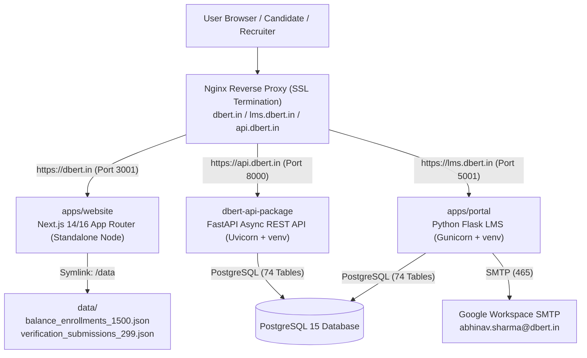

# DBERT Ecosystem: Website, LMS Portal & REST API
================================================================================
**Universal Documentation for Engineers & AI Agents**  
**Active Production Domain**: [https://dbert.in](https://dbert.in)  
**Production Host**: AWS EC2 (`ubuntu@3.26.237.171`)  

---

## 1. Ecosystem Overview & Architecture

The DBERT (Digital Blaize Ecosystem for Research & Training) platform is an integrated, production-grade education, credentialing, and internship hiring infrastructure comprising three core runtime services reverse-proxied by Nginx on AWS EC2:



### 1.1. Core Production Services
1. **Public Marketing & Verification Portal (`apps/website`)**:
   - Next.js 14/16 App Router application running in Node.js standalone mode on port 3001 (`dbert-website.service`).
   - Handles public landing pages, candidate search directory (`/verify/directory`), instant certificate verification engine (`/verify/[certId]`), and incubation balance enrollment portal (`/enroll/1999`, `/eroll`).
2. **Student & Administration LMS Portal (`apps/portal`)**:
   - Python Flask monolith running via Gunicorn on port 5001 (`dbert-portal.service`) with Python virtual environment (`.venv`).
   - Powers the student learning dashboard, courses catalog, 1:1 mentor bookings, task submissions, ambassador coins ledger, and staff/admin review queues.
3. **High-Performance REST Backend (`dbert-api-package`)**:
   - Modern FastAPI async REST backend running via Uvicorn on port 8000 (`dbert-api.service`).
   - Exposes 88+ REST endpoints, Pydantic v2 schemas, interactive Swagger documentation (`/docs`), and JWT multi-role authentication.

---

## 2. Directory Structure Map (Normalized & Pristine)

```
.
├── .agent/                             # Agent memory, architectural reports, and state tracking
├── .agents/
│   └── rules/                          # Operational rules and guidelines
├── apps/
│   ├── portal/                         # Flask LMS Platform (app.py, wsgi.py, routes/, services/, templates/)
│   └── website/                        # Next.js App Router (src/app/, components/, public/, prisma/)
├── archive/                            # Safety backup archives (git-ignored)
├── data/                               # Live candidate registries, balance enrollments & campaign logs
│   ├── sources/                        # Historical source CSV datasets (git-ignored)
│   ├── all_409_provisional_registry.json # Master registry for 409 provisional candidates
│   ├── balance_enrollments_1500.json   # CRITICAL: Live candidate balance enrollment records
│   ├── verification_submissions_299.json # CRITICAL: Live ₹299 verification submissions
│   ├── sheet_1593_provisional_registry.json # Master registry for Sheet 1593
│   ├── sheet_859_registry.json         # Master registry for Sheet 859
│   └── quota_watchdog_state.json       # SMTP watchdog circuit-breaker state
├── dbert-api-package/                  # FastAPI REST Backend (backend/, alembic.ini, Dockerfile)
├── deploy/                             # Production Nginx configurations and systemd service templates
├── design/                             # Design system reference files
├── docs/                               # Ecosystem documentation
│   ├── audit/                          # Architectural audit reports and hardening plans
│   ├── dbert-roadmap/                  # Roadmap specifications and route inventories
│   ├── presentations/                  # Program slide decks and presentation materials
│   ├── reports/                        # External QA and audit docx reports
│   └── samples/                        # Reference certificate samples
├── logs/                               # Application log dumps
├── scripts/                            # 35 Curated Canonical Production Scripts
│   ├── bat/                            # Windows batch automation launchers (git-ignored)
│   ├── scrapers/                       # Omnichannel internship scraping adapters
│   ├── deploy_*.py                     # Automated EC2 deployment scripts
│   ├── dispatch_*.py                   # Production email campaign daemons
│   ├── send_dbert_whatsapp.py          # Playwright WhatsApp dual-worker automation engine
│   ├── quota_watchdog_and_dispatcher.py # Automated SMTP quota monitor & pipeline launcher
│   └── verify_*.py                     # End-to-end health & verification probes
├── uploads/                            # Staged uploads and reference assets
├── .gitignore                          # Strict git ignore definitions
├── AGENTS.md                           # Universal Architectural Context & Playbook
├── GEMINI.md                           # Universal Architectural Context & Playbook (Mirror)
└── README.md                           # This Ecosystem Guide
```

---

## 3. Production Server Deployment & Management

### 3.1. Infrastructure Details
- **Host**: `ubuntu@3.26.237.171`
- **SSH Key**: `C:\Users\user\.ssh\dbert-production-server.pem`
- **Base Directory**: `/var/www/dbert-website-lms`
- **Systemd Services**:
  - `dbert-website.service` (Port 3001, Node standalone)
  - `dbert-portal.service` (Port 5001, Gunicorn Python 3.10+)
  - `dbert-api.service` (Port 8000, Uvicorn FastAPI)
  - `nginx.service` (SSL termination for `dbert.in`, `lms.dbert.in`, `api.dbert.in`)

### 3.2. Common Operations Commands
```bash
# Check service health
ssh -i "C:\Users\user\.ssh\dbert-production-server.pem" ubuntu@3.26.237.171 "systemctl status dbert-website dbert-portal dbert-api"

# Restart all services
ssh -i "C:\Users\user\.ssh\dbert-production-server.pem" ubuntu@3.26.237.171 "sudo systemctl restart dbert-website.service dbert-portal.service dbert-api.service nginx.service"

# View live portal error logs
ssh -i "C:\Users\user\.ssh\dbert-production-server.pem" ubuntu@3.26.237.171 "sudo journalctl -u dbert-portal.service -f -n 50"

# View live website logs
ssh -i "C:\Users\user\.ssh\dbert-production-server.pem" ubuntu@3.26.237.171 "sudo journalctl -u dbert-website.service -f -n 50"
```

---

## 4. Key Workflows & Lifecycle Logic

### 4.1. The 5-Stage Candidate Lifecycle (`apps/portal`)
1. **Stage 1: APPLIED** (`stage_num: 1`) - Candidate created account; pending domain declaration and statement of purpose. Payment form is locked.
2. **Stage 2: UNDER_REVIEW** (`stage_num: 2`) - Application submitted and under review by admissions mentors. Payment form is locked.
3. **Stage 3: SELECTED** (`stage_num: 3`) - Candidate approved for cohort. Prompts candidate to select a joining Monday and unlock the ₹499 caution deposit / ₹1,999 incubation payment.
4. **Stage 4: PAYMENT_PENDING** (`stage_num: 4`) - Candidate uploaded transaction receipt / UTR. Admin verification in progress.
5. **Stage 5: CONFIRMED / ENROLLED** (`stage_num: 5`) - Payment verified by admin. Seat confirmed, auto-enrolled into domain course workspace.

### 4.2. The 4 Stipend Release Gates (`/stipend/tasks`)
1. **Gate 1: Verified Credential**: Candidate must possess a non-provisional, cryptographically verified certificate (`status: "VERIFIED"`, `isProvisional: false`).
2. **Gate 2: 60-Day Completion Maturity**: Intern can only submit the stipend claim on or after their official completion date (`joining_date + 60 days`). A live countdown timer is shown prior to maturity.
3. **Gate 3: Encrypted UPI Verification**: Candidate must configure and confirm their Fernet-encrypted UPI ID on their profile.
4. **Gate 4: Domain Capstone & AI Rubric**: Intern submits GitHub repository URL, live deployment URL, and technical report PDF. Gemini AI evaluates deliverables against domain rubrics, staff performs final approval, and 5,000 coins are credited to the withdrawable wallet.

---

## 5. Security & Deliverability Rules
- **Domain Sovereign Rule**: All active URLs, canonical tags, API routes, and emails MUST use `https://dbert.in` (legacy `dbert.online` is retired).
- **Google Workspace SMTP**: Authenticated sender is strictly `abhinav.sharma@dbert.in`.
- **Database Security**: Production database runs PostgreSQL 15. All SQLite files are strictly for local/offline testing and never committed to Git.
