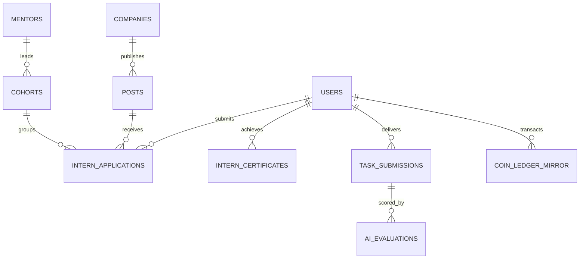

# DBERT Data Model & Persistence Architecture
**Audit As-of Date:** 9 November 2026  
**Auditor:** Antigravity AI Engine  

---

## 1. Unified Storage Hierarchy

DBERT utilizes a resilient dual-layer data architecture:
1. **Primary Relational Layer (PostgreSQL `dbert_lms`)**: Handles operational LMS entities, user sessions, permissions, student applications, company postings, task submissions, and coin balances.
2. **Local Failover / Rapid Read Cache (SQLite & JSON Master Registries)**: Powers static site generation (SSG) in Next.js, candidate autofill APIs, cryptographic certificate verification, and offline batch dispatch state.

---

## 2. PostgreSQL Tables (`dbert_lms` Database / `dbert_internship` Schema)

| Table Name | Purpose | Key Attributes | Privacy Level |
|---|---|---|---|
| `users` | Primary user identity (Learner, Mentor, Staff, Admin) | `id`, `email`, `password_hash`, `role`, `status`, `phone_encrypted`, `upi_encrypted`, `created_at` | Confidential (PII) |
| `companies` | Employer / startup accounts | `id`, `name`, `industry`, `website`, `is_verified`, `billing_email`, `status` | Semi-Public |
| `posts` | Job & internship postings created directly by employers | `id`, `company_id`, `post_type`, `domain`, `title`, `slug`, `stipend_min`, `stipend_max`, `status`, `expires_at` | Public |
| `scraped_internships`| Externally aggregated internship leads | `id`, `Company`, `Role`, `Domain`, `Location`, `URL`, `Stipend`, `Source`, `Work_Model` | Public |
| `intern_applications`| Student submissions to posts or cohorts | `id`, `intern_id`, `post_id`, `cohort_id`, `status` (applied/screening/offered/active/completed), `reviewed_by` | Private |
| `tasks` | Domain-specific technical sprint assignments | `id`, `domain`, `title`, `description`, `rubric_json`, `max_coins`, `due_date` | Authenticated |
| `task_submissions` | Learner sprint deliverables & proof | `id`, `task_id`, `intern_id`, `github_pr_url`, `demo_url`, `report_pdf_path`, `status`, `ai_score`, `staff_approved_at` | Restricted |
| `intern_certificates`| Official credential records | `id`, `certificate_id` (e.g. `CERT-DBERT-2026-DA-001`), `intern_id`, `domain`, `score`, `status` (VERIFIED/PROVISIONAL), `issue_date` | Publicly Verifiable by Exact ID |
| `coin_ledger_mirror`| LMS wallet and stipend coin transactions | `id`, `user_id`, `amount` (e.g. 5000), `ledger_kind` (referral/stipend), `balance_after`, `description` | Private Financial |
| `payout_requests` | Intern stipend withdrawal requests | `id`, `user_id`, `coins_redeemed`, `inr_amount`, `upi_id_decrypted`, `status` (pending/approved/disbursed), `admin_id` | Private Financial |

---

## 3. Master JSON Datasets (`data/` & `apps/website/src/data/`)

| File Path | Records | Role in Platform |
|---|---|---|
| `certificates_registry.json` | 465 records | SSG and runtime lookup for public certificate verification (`/verify/[certId]`). Includes 65 verified candidates and 400 provisional candidates. |
| `directory_candidates.json` | 465 records | Powers the Pre-Vetted Engineers Directory (`/verify/directory`). Contains technical stacks, hireability scores, Turnitin integrity marks, and verification badges. |
| `balance_enrollments_1500.json`| Dynamic | Live database of ₹1,500 balance submissions, 12-digit UTR records, and candidate confirmation statuses. |
| `dispatch_tracking_409.json` | 409 records | State persistence for provisional candidate email dispatch. Tracks delivery timestamps, Message-IDs, and delivery statuses. |
| `dbert_whatsapp.db` | SQLite WAL | Dual-account WhatsApp queue and sent logs (`whatsapp_dispatch`, `whatsapp_sent_log`) ensuring zero duplicate message deliveries. |

---

## 4. Candidate Privacy Classification

1. **Public Domain (Zero PII Exposed)**:
   - Certificate ID (e.g. `CERT-DBERT-2026-AIML-092`), Candidate First Name + Last Initial, Certified Domain Track, Issue Date, Rubric Scores, Verification Badge.
2. **Restricted Domain (Recruiter / Consented Only)**:
   - Full Candidate Name, GitHub Profile / PR links, Turnitin Originality Report, Recommendation Letter.
3. **Strictly Confidential (Never Exposed / Encrypted)**:
   - Student Phone Number, Student Personal Email, Bank / UPI Account ID, Payment UTR Receipts, Password Hashes.
