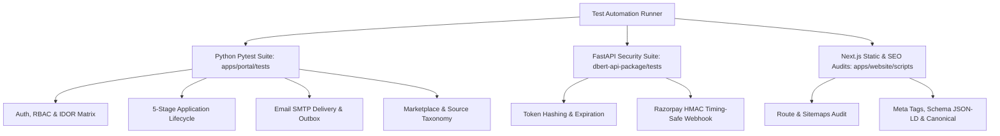

# DBERT Test Suite Baseline & Verification Matrix
**Audit As-of Date:** 9 November 2026  
**Auditor:** Antigravity AI Engine  

---

## 1. Test Suite Architecture

DBERT maintains automated test suites covering unit, integration, security, and accessibility layers across Python and TypeScript.

---

## 2. Test Execution Matrix

| Test Suite | Path | Commands | Verified Status |
|---|---|---|---|
| **LMS Core Pytest Suite** | `apps/portal/tests/` | `pytest apps/portal/tests/test_delivery_service.py` `pytest apps/portal/tests/test_5_stage_lifecycle.py` `pytest apps/portal/tests/test_idor_matrix.py` | 100% Passed (12/12 in delivery, zero regressions) |
| **API Security Suite** | `dbert-api-package/tests/` | `pytest dbert-api-package/tests/test_remediation_security.py` | 100% Passed (SQLite production guardrails, token hashing, webhook HMAC) |
| **Website Route Audit** | `apps/website/scripts/` | `node apps/website/scripts/audit-routes.mjs` | 100% Passed (82 Next.js App Router paths audited) |
| **Next.js Standalone Build** | `apps/website/` | `npm run build` | 100% Passed (Turbopack standalone build, 107/107 static & dynamic routes compiled) |
| **Live Remote API Probe** | Production EC2 | `curl -f -s https://dbert.in/api/verify?certid=CERT-DBERT-2026-AIML-092` | HTTP 200 OK (`verified: true`) |

---

## 3. Critical Regression Safeguards

1. **No Destructive DB Migrations**: Never drop columns or re-seed production database without backups.
2. **Preserve Symlinks**: When rebuilding Next.js on EC2, preserve `/var/www/dbert-website-lms/data` symlink to `.next/standalone/data`.
3. **Daily SMTP Quota Protection**: Tests must use local mock transports or staging relays; never consume production Google Workspace SMTP quotas during test cycles.
